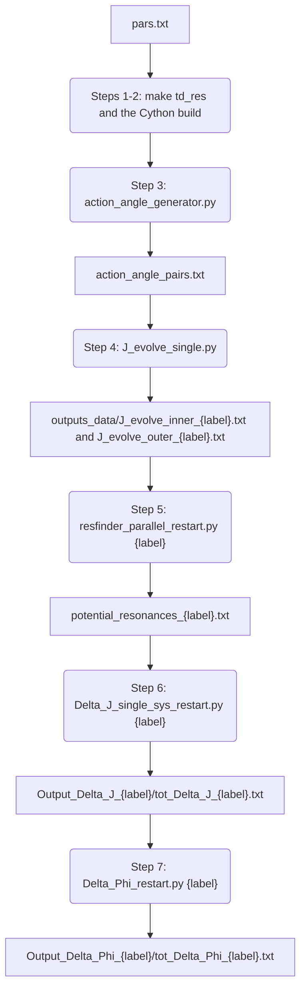

# gr-resonance-tools

Aloha mai kākou! gr-resonance-tools is our toolkit for computing the tidal resonances that a dynamical third body causes in an extreme mass ratio inspiral (EMRI) around a Kerr black hole. It is written in C, with Python (Cython) drivers. This README explains how to install the code and run the pipeline behind our papers ([arXiv:2207.07733](https://arxiv.org/abs/2207.07733) and [arXiv:2507.22260](https://arxiv.org/abs/2507.22260)). It is also the reference for the units, inputs and outputs of every step, so you can adapt the code to your own systems. If you have any questions, you can reach the developers here:

- Christopher Hirata (hirata.10@osu.edu)
- Makana Silva (msilva23@ucsc.edu)
- Harrison Blake-Goszyk (h.g.blake-goszyk@vanderbilt.edu)

Me ke aloha pumehana!

## Contents

- [What the code computes](#what-the-code-computes)
- [Requirements](#requirements)
- [Installation and build](#installation-and-build)
- [Quick start: a short test run](#quick-start-a-short-test-run)
- [Units and conventions](#units-and-conventions)
- [Configuration: pars.txt](#configuration-parstxt)
- [Convergence notes](#convergence-notes)
- [The pipeline step by step](#the-pipeline-step-by-step)
- [Resonance-aware evolution](#resonance-aware-evolution)
- [Output file reference](#output-file-reference)
- [Running on a cluster](#running-on-a-cluster)
- [Testing and debugging](#testing-and-debugging)
- [Python interface (gr_wrapper)](#python-interface-gr_wrapper)
- [Known issues and gotchas](#known-issues-and-gotchas)
- [Repository layout](#repository-layout)
- [Citing](#citing)

## What the code computes

An inner compact body (the "inner" or "First" body) inspirals into a supermassive black hole (SMBH) of mass $M$ and spin $a$. A second body (the "outer" or "Second" body, the perturber) orbits the same black hole farther out. Each orbit is a Kerr geodesic labelled by its action variables $J = (J_r, J_{\theta}, J_{\phi})$. Its three fundamental frequencies are $\Omega = (\Omega_r, \Omega_{\theta}, \Omega_{\phi})$. Both orbits shrink slowly as they radiate gravitational waves.

A resonance happens when a harmonic of the inner orbit has the same frequency as a harmonic of the outer orbit:

$$
n_\mathrm{in}\,\Omega_{r,\mathrm{in}} + k_\mathrm{in}\,\Omega_{\theta,\mathrm{in}} + m\,\Omega_{\phi,\mathrm{in}}
= n_\mathrm{out}\,\Omega_{r,\mathrm{out}} + k_\mathrm{out}\,\Omega_{\theta,\mathrm{out}} + m\,\Omega_{\phi,\mathrm{out}} .
$$

The integers $(n, k, m)$ label harmonics of the radial, polar and azimuthal motion, and both sides share the same m. As the inspiral passes through a resonance, the outer body's tidal field changes the inner body's actions by a small jump $\Delta J$. Silva & Hirata (2022) showed that $\Delta J$ can be written in terms of the Teukolsky $\psi_4$ amplitudes at the horizon and at infinity, evaluated at the resonant frequency, so the code never needs the metric perturbation itself. The jump shifts the inner body's frequencies for the rest of the inspiral, which builds up a phase shift $\Delta \Phi$ in the gravitational waveform.

The pipeline runs in seven steps. Step 0 is choosing the parameters. In the file names below, `{label}` is the integer system label (see [System labels](#system-labels)).



Steps 4 to 7 evolve each body without the jumps and estimate their effect afterwards. [Resonance-aware evolution](#resonance-aware-evolution) describes a driver that instead evolves the actions and angles of both bodies together and applies each jump at its crossing.

These papers describe the methods the code implements:

| arXiv | Paper | What it contributes here |
|---|---|---|
| [1010.0758](https://arxiv.org/abs/1010.0758) | Hirata 2011, *Lindblad resonance torques in relativistic discs I: Basic equations* (MNRAS 414, 3198) | Gauge-invariant resonance torques in stationary, axisymmetric spacetimes |
| [1010.0759](https://arxiv.org/abs/1010.0759) | Hirata 2011, *Lindblad resonance torques in relativistic discs II: Computation of resonance strengths* | Relates the torques to the gravitational waveforms of the perturber and a test particle; the origin of the CKerr core (Kerr geodesics and the Teukolsky mode solvers) |
| [1011.4987](https://arxiv.org/abs/1011.4987) | Hirata 2011, *Resonant recoil in extreme mass ratio binary black hole mergers* (PRD 83, 104024) | Resonance crossings during Kerr inspirals, and how resonant effects scale as the square root of the mass ratio |
| [2207.07733](https://arxiv.org/abs/2207.07733) | Silva & Hirata 2022, *Dynamical perturbations around an EMRI near resonance* | ΔJ from the ψ₄ amplitudes for generic Kerr orbits, in the static and dynamical limits |
| [2507.22260](https://arxiv.org/abs/2507.22260) | Silva, Blake-Goszyk & Hirata 2025, *Resonant interactions from dynamical perturbers on generic orbits around an EMRI* | The current pipeline: generic outer orbits, many resonances per system, a range of spins |

## Requirements

- **A C compiler with OpenMP.** On macOS, Apple's clang has no `-fopenmp`, so install GCC with Homebrew (`brew install gcc`), which provides `gcc-15`. The Makefile uses `CC = gcc-15`. On Linux or a cluster, change that line to `CC = gcc` (a commented-out version is just above it).
- **Perl 5**, to run `pars.pl`.
- **Python 3** with numpy, scipy, Cython and setuptools: `pip install numpy scipy cython setuptools`.
- **make.**

The code has been tested with macOS 26.6, Homebrew GCC 15.2.0, Perl 5.34.1, Python 3.10.8, numpy 1.24.2, scipy 1.15.3, Cython 0.29.32 and setuptools 65.5.0.

## Installation and build

Run every command from the repository root, the directory that holds the `Makefile`. The Python drivers use paths relative to it, such as `td_res_exe/` and `outputs_data/`.

```bash
git clone https://github.com/hirata10/gr-resonance-tools.git
cd gr-resonance-tools

make td_res          # pipeline executables, in td_res_exe/
make test            # optional: debug executables, in test_exe/

# Cython module gr_wrapper, used by steps 3 and 5
cd src/python
CC=gcc-15 python setup.py build_ext --inplace --force    # on Linux, use CC=gcc or leave CC unset
cd ../..
```

`make td_res` first runs `perl pars.pl`. That script turns `pars.txt` into two files: `src/C/globalpars_c.h`, with one `#define GLOBALPAR_<name> <value>` per parameter, and `src/python/globalpars.py`, with one `GLOBALPAR_<name> = <value>` per parameter. `make td_res` then builds five executables in `td_res_exe/`: `J_evolve_single_start`, `J_evolve_single_restart`, `Delta_J_single` and `Delta_Phi_single` for steps 4 to 7, and `J_psi_step` for the [resonance-aware evolution](#resonance-aware-evolution). On macOS, the Cython build needs `CC=gcc-15` because `setup.py` compiles with `-fopenmp`.

**After you edit `pars.txt`, rebuild.** The parameter values are compiled into the executables. `make td_res` and `make test` notice the change and rebuild by themselves. The Cython module doesn't, so rerun the `setup.py` command with `--force`. Never edit `globalpars_c.h` or `globalpars.py` by hand. They are regenerated from `pars.txt` and aren't tracked by git.

**Compiler flags.** Everything is built with `-O2 -ffp-contract=off`, which gives bit-for-bit the same results as `-O0`. Pipeline executables are built with `-w`, which hides all warnings, and debug executables with `-Wall -g`. To step through the code in a debugger (e.g., VSCode `Run and Debug`), rebuild with `make clean-test && make test OPTFLAGS=-O0`.

**The step 6 routine.** By default `Delta_J_single` computes $\Delta J$ of both bodies from the tidal resonance amplitudes (`J_dot_tidal_amplitudes_openmp` and `Delta_J_from_amplitudes`). `make clean-td_res && make td_res DELTA_J=original` builds it with the earlier serial routine `Delta_J_tidal2` instead, which includes only the inner body $\Delta J$, 27 output columns, and the angular acceleration $\Gamma$ always taken from the command line (computed from J_evolve data). Use that build for comparisons, and don't mix its output files with those of the default build.

**The orbit cache in step 6.** By default the tidal amplitudes read each orbit from a cache that is built once per body and shared by all harmonics (`src/C/radialfunc_cached.c`, the cache the self-force sum uses). `make clean-td_res clean-test && make td_res test TIDAL_AMP=original` builds `Delta_J_single`, `DELTA_J_TIDAL_OMP` and `DELTA_J_TIDAL_AB` without it, calling `CKerr_RadialFunc` for every harmonic. In the resonances tested that gives the same $\Delta J$ to a fractional difference of 10⁻¹² or better, at about eight times the CPU time for `nl_res` = 4 and `N_res` = 5 ([Tidal sum](#tidal-sum-step-6-and-the-debug-tools)). Use the uncached code to check a change to the cached code.

**Cleaning up:**

| Target | What it does |
|---|---|
| `make clean-td_res` | removes `td_res_exe/` |
| `make clean-test` | removes `test_exe/` |
| `make clean-data` | **moves** (doesn't delete) `outputs_data/`, `Output_Delta_J_*`, `Output_Delta_Phi_*`, `potential_resonances_*`, `precomputed_omegas_*`, `action_angle_pairs.txt` and the generated globals into `dump/dump-<timestamp>/` |
| `make clean` | all three |

## Quick start: a short test run

This runs every step for one small system. With these settings it took a little over 2 hours on a 10-core Mac. It tests the machinery but isn't a physical result: the J evolution covers only a short stretch of the inspiral, and the mode sums are heavily truncated.

First, set `pars.txt` to the values in the *Quick start* column of the [parameter table](#configuration-parstxt). Then:

```bash
# Steps 1-2: build
make td_res
(cd src/python && CC=gcc-15 python setup.py build_ext --inplace --force)

# Step 3: one system with known initial actions
#   columns: label, inner J_r J_theta J_phi, outer J_r J_theta J_phi
echo "1 2.322277 1.374186 3.374605 0.201801 7.29584 6.64418" > action_angle_pairs.txt

# Step 4: evolve both bodies. J_evolve_single.py needs at least 2 systems,
# so for one system run the two commands it would run.
#   arguments: J_r J_theta J_phi t0 n_time mu label inner|outer i_start
export OMP_NUM_THREADS=5
mkdir -p outputs_data
td_res_exe/J_evolve_single_start 2.322277 1.374186 3.374605 1.0 10 1e-05 1 inner 1 >> outputs_data/J_evolve_inner_1.txt &
td_res_exe/J_evolve_single_start 0.201801 7.29584 6.64418 1.0 3 1e-05 1 outer 1 >> outputs_data/J_evolve_outer_1.txt &
wait

# Step 5: find the resonances of system 1
python src/python/resfinder_parallel_restart.py 1

# Optional: keep 10 evenly spaced resonances, to make steps 6 and 7 short
cp potential_resonances_1.txt potential_resonances_1_full.txt
python -c "import numpy as np; L=open('potential_resonances_1_full.txt').read().splitlines(); open('potential_resonances_1.txt','w').write('\n'.join(L[i] for i in np.round(np.linspace(0,len(L)-1,10)).astype(int))+'\n')"

# Step 6: Delta J at each resonance
python src/python/Delta_J_single_sys_restart.py 1

# Step 7: Delta Phi at each resonance
python src/python/Delta_Phi_restart.py 1
```

The run this README is based on gave these results:

| Step | Wall time | What you should see |
|---|---|---|
| 4 | 64 min (2 processes $\times$ 5 threads) | `J_evolve_inner_1.txt` has rows i = 0 to 9 and ends at t ≈ 1.477 × 10¹⁰. Row 1 has J = (2.32218885170849, 1.36070812892435, 3.34010024030387). `J_evolve_outer_1.txt` has rows 0 to 2 and ends at t ≈ 6.39 × 10¹⁰. |
| 5 | 33 min (1 core) | 211 resonances in `potential_resonances_1.txt` before trimming |
| 6 | 3 min (5 processes of 1 thread; 46 s of CPU per resonance on average, 20 s to 102 s). The earlier routine `Delta_J_tidal2` took 28 min on the same ten resonances in October 2026. | 10 rows of 34 columns in `Output_Delta_J_1/tot_Delta_J_1.txt` |
| 7 | 30 min (5 processes) | 10 rows of 16 columns in `Output_Delta_Phi_1/tot_Delta_Phi_1.txt` |

Your ΔJ and ΔΦ values will differ from these, because step 6 draws a random resonant angle for each resonance. The checks in [Checks after a run](#checks-after-a-run) should pass every time.

## Units and conventions

### Units of each quantity

The code uses geometric units, G = c = 1, with lengths and times in units of the SMBH mass M. `pars.txt` sets `M 1.0`; keep it at 1. The spin is `astar` = a/M. The two bodies enter only through their mass ratios, `mu_inner` = μ_in/M and `mu_outer` = μ_out/M.

| Quantity | Names in the code and files | Units |
|---|---|---|
| Black hole mass | `M` | the unit of mass, of length (GM/c²) and of time (GM/c³) |
| Spin | `astar` | dimensionless, a/M |
| Mass ratios | `mu_inner`, `mu_outer` | dimensionless, μ/M |
| Actions | `J_r`, `J_theta`, `J_phi` | per unit mass of the body (J/μ); units of M |
| Energy | `E` (`EQL[0]`) | per unit body mass; dimensionless; E < 1 for bound orbits |
| Carter constant | `Q` (`EQL[1]`) | per unit body mass squared; units of M² |
| Axial angular momentum | `L` (`EQL[2]`) | per unit body mass; units of M; equal to J_φ |
| Radii | `ra`, `rp`, `sm_axis_*` | M (Boyer–Lindquist radius) |
| Inclination | `I` | radians |
| Frequencies | `Omega_r`, `Omega_theta`, `Omega_phi` | 1/M, with respect to Boyer–Lindquist coordinate time |
| **Times | `t`, `dt`, `t0`, `t_res`, `t_scale` | M (Boyer–Lindquist coordinate time) |
| **Rate of change of a resonant frequency | `omega_dot_*`, `gamma` (Γ) | 1/M² |
| Resonant angle | `theta_res` | radians |
| **Jumps in the actions | `Delta_J_r`, `Delta_J_theta`, `Delta_J_phi` and the `Delta_J_*_outer` columns | like the actions: per unit mass of the inner body, and per unit mass of the outer body for the `_outer` columns |
| **Phase shifts | `Delta_Phi_*` | radians |

- Note: **() These depend on the mass ratios; see [Mass ratios and time](#mass-ratios-and-time). Files written before November 2026 hold them in other units; see [Files from earlier versions](#files-from-earlier-versions).

In the Newtonian limit, J_r + J_θ + |J_φ| = √(Ma), where a is the semi-major axis. `action_angle_generator.py` uses this relation to set the orbit sizes.

### Mass ratios and time

Every time in the code is Boyer–Lindquist coordinate time in units of M. The two mass ratios set how fast things happen:

- **Inspiral (step 4).** The self-force changes a body's actions, per unit body mass, at a rate proportional to that body's mass ratio: dJ/dt = μ_body × (the rate for a unit mass ratio). `J_dot_selfforce_openmp` takes `mu_body` and returns this product. So a body ten times lighter goes through the same sequence of J values ten times more slowly.
- **Γ (step 5).** resfinder differentiates the two resonant frequencies along those J(t) tracks, so ω̇_in is proportional to μ_in and ω̇_out to μ_out.
- **ΔJ (step 6)** is proportional to μ_out / √|Γ|.
- **ΔΦ (step 7)** is proportional to t_scale × ΔJ, and t_scale is proportional to 1/μ_in.

When both mass ratios equal μ, the time to cover a given stretch of the inspiral scales as 1/μ, Γ as μ, ΔJ as √μ and ΔΦ as 1/√μ.

The debug tools `J2J_DOT_SF`, `J2J_DOT_SF_OMP` and `GAMMA_EQ17` take the mass ratios as inputs, so they print J̇ and Γ in the same units as the pipeline.

**Legacy routines.** The source keeps an older set of routines for reference: the serial `J_dot_selfforce` and the routines built on it (`J2Jdot`, `J2Jdot_component`, `rk4_J2Jdot`, `rk4_J2Jdot_restart`, `omega_dot` and `Delta_J_tidal`), with the Python wrappers `j_dot_selfforce`, `j2jdot`, `j2jdot_component` and `omegadot`. They are outdated and marked `LEGACY` in the code. They return rates for a unit mass ratio, and the pipeline doesn't use them. Of the debug tools, only the serial `J2J_DOT_SF` calls one of them.

### Files from earlier versions

Before November 2026, steps 4 and 7 computed the self-force J̇ for a unit mass ratio. The time in those versions was therefore a "code time" τ = μ_body · t, and Γ, ΔJ and ΔΦ inherited it. Files written by those versions convert to the present units as follows, provided `mu_inner` = `mu_outer` = μ:

| Quantity | Where it appears | Conversion |
|---|---|---|
| t − t0 and dt | J-evolution files; `precomputed_omegas` column 1; `potential_resonances` columns 2 and 31 | divide by μ |
| ω̇ and Γ | `potential_resonances` columns 3, 4 and 7; ΔJ column 8 | multiply by μ |
| ΔJ and ΔJ/J | ΔJ columns 21 to 26 | divide by √μ |
| t_scale | ΔΦ column 11 | divide by μ |
| ΔΦ | ΔΦ columns 12 to 15 | divide by μ^(3/2) |

Actions, frequencies, (E, Q, L) and radii are the same in both. With unequal mass ratios, those versions put the two bodies on different time axes in step 5, so their resonance lists can't be converted: rerun from step 4.

### Converting to physical units

GM☉/c³ = 4.925491 × 10⁻⁶ s and GM☉/c² = 1.476625 km. For a black hole of mass M:

- **time:** t[s] = t[M] × 4.925491 × 10⁻⁶ s × (M/M☉);
- **length:** r[km] = r[M] × 1.476625 × (M/M☉);
- **frequency:** f[Hz] = Ω[1/M] / (2π × 4.925491 × 10⁻⁶ s × (M/M☉)).

For example, the quick-start inner orbit starts with Ω_φ = 3.667 × 10⁻³ /M. For M = 10⁶ M☉, that is f_φ = 1.19 × 10⁻⁴ Hz, which puts its m = 2 harmonic at 2.37 × 10⁻⁴ Hz, in the LISA band. Its J evolution ends at t = 1.477 × 10¹⁰ M, which is 7.28 × 10¹⁰ s, or about 2,300 years.

### Orbit parameterizations

The code moves between three descriptions of a bound Kerr geodesic:

| Description | Array layout | Converted by |
|---|---|---|
| Actions J = (J_r, J_θ, J_φ) | `J[0] = J_r`, `J[1] = J_θ`, `J[2] = J_φ` | `CKerr_J2EQL` (J to EQL) and `CKerr_EQL2J` (EQL to J), in `kerrtraj.c` |
| Constants of motion (E, Q, L) | `EQL[0] = E`, `EQL[1] = Q`, `EQL[2] = L` | as above |
| Orbit shape (r_a, r_p, I) | `ancillary[0] = I`, `ancillary[1] = r_p`, `ancillary[2] = r_a`, as filled in by `CKerr_EQL2J` | `ra_rp_I2EQL`, in `resonance_find.c` |

The frequencies come from `CKerr_Minverse(J)`, which returns the 3×3 matrix M⁻¹ as 9 numbers in row order, followed by `CKerr_Minv2Omega`.

- **Inclination:** I = π/2 − θ_min, where θ_min is the smallest polar angle the orbit reaches. For retrograde orbits (L < 0), I is replaced by π − I (line 203 of `kerrtraj.c`). So I = 0 is prograde equatorial, I = π/2 is polar, and I = π is retrograde equatorial.
- **Eccentricity:** e = (r_a − r_p)/(r_a + r_p).
- **Inner and outer:** the newer prompts in `calling.c` say "First body" and "Second body" for `RESFIND_APO_GENERIC` (since its function is to find the apocenter of one orbit given the full data (apocenter, pericenter, and inclination) of the other orbit), but variable and file names still say inner and outer.

### Mode vectors and resonances

A harmonic of an orbit is labelled by integers (n, k, m) for the (r, θ, φ) motion, and its frequency is ω = nΩ_r + kΩ_θ + mΩ_φ. A resonance pairs an inner harmonic (n_in, k_in, m) with an outer harmonic (n_out, k_out, m). The two harmonics share m (the selection rule m_inner = m_outer), so the files store a single m.

`resfinder_parallel_restart.py` searches as follows:

- n_in, k_in, n_out and k_out each run over `range(N_min_Fourier, N_max_Fourier)`. That is Python's range, so the upper value is excluded: with −5 and 5, each runs from −5 to 4.
- For each combination, it computes the m that would satisfy the resonance condition at each time, m(t) = (n_out Ω_r,out + k_out Ω_θ,out − n_in Ω_r,in − k_in Ω_θ,in) / (Ω_φ,in − Ω_φ,out). It records a resonance wherever m(t) crosses an integer, provided that |m| ≤ N_max_Fourier.
- It keeps only combinations with k_in − k_out even.
- It keeps a combination only if gcd(n_in, n_out, k_in, k_out, m) is 1, or if it is 2 and (k_in − k_out)/2 is odd.
- Of each pair of mode vectors (N, −N), it keeps one, chosen by a lexicographic sign test on (m, n_in, n_out, k_in, k_out).

### System labels

Two different things are called a "system label":

- The **integer label** is column 0 of `action_angle_pairs.txt` (1, 2, …). It is the `{label}` in every output file name, such as `J_evolve_inner_{label}.txt`, `potential_resonances_{label}.txt` and `Output_Delta_J_{label}/`. It is also the command-line argument of steps 5 to 7.
- The **string** `system_label` in `pars.txt` (for example `"50_200-0.9"`) is a run name. Only the old `Delta_Phi_single.py` reads it.

## Configuration: pars.txt

`pars.txt` holds every run parameter. It follows three rules:

- Each line is `<name> <value>`, exactly two tokens separated by whitespace. A line with any other number of tokens is skipped without a warning, so don't put a comment on the same line as a value. Lines that start with `#` are comments.
- Each value is copied as is into C (`#define GLOBALPAR_<name> <value>`) and into Python (`GLOBALPAR_<name> = <value>`), so it must be valid in both languages. Write numbers plainly, and put strings in double quotes.
- The values are compiled in, so rebuild after any change (see [Installation and build](#installation-and-build)).

| Parameter | Quick start | Meaning | Used in |
|---|---|---|---|
| `M` | `1.0` | SMBH mass; the unit of mass, length and time. Keep it at 1. | every step |
| `astar` | `0.9` | SMBH spin a/M | every step |
| `mu_inner` | `0.00001` | inner body's mass ratio μ_in/M | step 4, where it sets the rate of the inner body's inspiral ([Mass ratios and time](#mass-ratios-and-time)); step 5 (column 5); step 7 (t_scale) |
| `mu_outer` | `0.00001` | outer body's mass ratio μ_out/M | step 4, where it sets the rate of the outer body's inspiral; step 5 (column 6); step 6, where ΔJ scales with it |
| `i_start_inner`, `i_start_outer` | `1`, `1` | index of the first RK4 step in a fresh run. Keep it at 1; restarts set their own. | step 4 |
| `n_time_inner`, `n_time_outer` | `10`, `3` | rows in each J-evolution file: row 0 (the initial J) plus n_time − 1 RK4 steps, unless the orbit plunges first | step 4 |
| `sm_axis_inner`, `sm_axis_outer` | `50`, `200` | orbit sizes in M for the random initial actions: the generator draws J with J_r + J_θ + J_φ = √(sm_axis). The Kerr orbit's (r_a + r_p)/2 comes out smaller: 44.5 instead of 50 for the quick-start inner orbit. | step 3 |
| `N_sys` | `1` | number of systems (inner–outer pairs) to generate | step 3 |
| `N_res` | `5` | ΔJ sums the harmonics j·(n, k, m) of each resonance for j = −N_res to N_res | step 6; the tidal J̇ debug tools |
| `nl_res` | `12` | number of ℓ values summed for each harmonic in ΔJ, counted from the ℓ that `nl_res_extend` selects | step 6; the tidal J̇ debug tools, where the count always starts at max(2, j\|m\|) |
| `nl_res_extend` | `0` | where the `nl_res` values of ℓ of harmonic j start. `0`: at max(2, j\|m\|), as in the earlier routine. `1`: at the first ℓ the harmonic couples to, max(2, j\|m\|, j\|m + k_in\|, j\|m + k_out\|). The ℓ below that one, down to max(2, j\|m\|), are summed as well, so `1` only ever adds terms ([Tidal sum](#tidal-sum-step-6-and-the-debug-tools)) | step 6 |
| `Nr_res`, `Nt_res` | `42`, `42` | radial and polar sizes of the grid of points along each orbit on which the tidal amplitudes are computed | step 6 |
| `Gamma_source` | `0` | where step 6 takes Γ from. `0`: `gamma` of `potential_resonances` (step 5). `1`: Eq. (17) of arXiv:2207.07733, computed at each resonance from the self-force of both bodies with `nl_self`, `nmax`, `kmax`, `mmax` on the `Nr_self` × `Nt_self` grid | step 6 |
| `N_min_Fourier`, `N_max_Fourier` | `-5`, `5` | resfinder searches N_min_Fourier ≤ n_in, k_in, n_out, k_out < N_max_Fourier, with \|m\| ≤ N_max_Fourier | step 5 |
| `t0` | `1.0` | initial time of the J evolution, in units of M | step 4 |
| `nl_self` | `2` | number of ℓ modes for each (n, k, m) in the self-force J̇ | steps 4 and 7 |
| `nmax`, `kmax`, `mmax` | `2`, `2`, `2` | the self-force J̇ sums over \|n\| ≤ nmax, \|k\| ≤ kmax and \|m\| ≤ mmax | steps 4 and 7 |
| `Nr_self`, `Nt_self` | `28`, `14` | radial and polar grid sizes of the mode integrals (`CKerr_RadialFunc`) in the self-force J̇ | steps 4 and 7 |
| `chunk_size` | `5` | how many jobs a driver starts at once: systems in step 4 (two processes each), resonances in steps 6 and 7 (also the number of rows in each chunk file) | steps 4, 6 and 7 |
| `tgrid_resfinder` | `100` | target number of points on resfinder's time grid | step 5 |
| `system_label` | `"50_200-0.9"` | run name; only the old `Delta_Phi_single.py` reads it | none |

The quick-start values are small, for testing. A production run differs in three ways:
- `n_time_*` must cover the part of the inspiral you care about.
- The outer run must span the inner run's time range.
- The self-force truncation (`nl_self`, `nmax`, `kmax`, `mmax`) and its grid (`Nr_self`, `Nt_self`) must be large enough for J̇ to converge, and `nl_res` and the grid `Nr_res` × `Nt_res` large enough for ΔJ. The right values depend on the orbits: [Convergence notes](#convergence-notes) lists measured settings and shows how to check one before a production run.

The [resonance-aware evolution](#resonance-aware-evolution) uses the parameters of steps 4 and 6 and needs `Gamma_source` = 0.

Step 7 computes the self-force J̇ behind t_scale on the same `Nr_self` × `Nt_self` grid as step 4. Step 6 uses these two parameters only when `Gamma_source` = 1. The tidal amplitudes behind ΔJ are computed on the `Nr_res` × `Nt_res` grid. A `pars.txt` without `nl_res_extend`, `Nr_res` or `Nt_res` gives 0, 42 and 42, the settings of the earlier routine.

## Convergence notes

The self-force J̇ (steps 4 and 7) and the tidal jump ΔJ (step 6) are sums over modes, evaluated on a grid of points along each orbit. Both sums are cut off, and the right cut-off depends on the orbit. An eccentric, inclined orbit with a pericenter in the strong field needs far more modes than a wide, nearly circular one, and the grids must grow with the number of modes. This section says which parameter follows which property of the orbit, lists measured settings, and shows how to check a setting yourself.


### How the numbers were measured

- **Every error in this section is a fractional error**, |result − reference| / |reference|, unless the line says it is absolute. An error of 10⁻³ means one part in a thousand of the quantity itself. The reference is a much larger sum, or a finer grid, computed with the same code.
- **Which quantity.** For the self-force, where a line doesn't name a component, it is the fractional error of J̇_r, which converges most slowly in n. For the tidal sum it is the fractional error of the inner body's tidal J̇; [the tidal subsection](#tidal-sum-step-6-and-the-debug-tools) says how that carries over to ΔJ.
- A table entry for one parameter was measured with the other parameters large enough not to matter. The fractional errors of separate parameters add, so give each one a third to a quarter of your target.
- The orbits are prograde, and the black hole spin is a* = 0.9 unless a line says otherwise. [Spin and the separatrix](#spin-and-the-separatrix) covers other spins.
- These tests show whether a sum has converged. They can't show an error shared by every mode. As an independent check, the summed energy flux of wide orbits (semi-major axis 50 M, e ≤ 0.2) agrees with the post-Newtonian flux formula to a fractional difference of about 0.1%.

### Which parameter follows which orbit property

| Parameter | Set in | What it limits | Set it from |
|---|---|---|---|
| `nmax` | `pars.txt` | radial harmonics, \|n\| ≤ `nmax`, in the self-force J̇ | the eccentricity |
| `mmax` | `pars.txt` | azimuthal harmonics, \|m\| ≤ `mmax` | the pericenter radius |
| `kmax` | `pars.txt` | polar harmonics, \|k\| ≤ `kmax` | the inclination |
| `nl_self` | `pars.txt` | number of ℓ for each (n, k, m), starting at ℓ = max(2, \|m\|) | the inclination and the pericenter radius |
| `Nr_self` | `pars.txt` | radial points of the orbit grid in each mode integral | `nmax` |
| `Nt_self` | `pars.txt` | polar points of that grid | `kmax` |
| `N_res` | `pars.txt` | harmonics j = ±1 … ±`N_res` of each resonance in ΔJ and in the tidal J̇ | keep at 5 |
| `nl_res` | `pars.txt` | number of ℓ for each harmonic in ΔJ and in the tidal J̇ | the ratio r_a,in / r_p,out of the two orbits; with `nl_res_extend` = 0 also the mode vectors |
| `nl_res_extend` | `pars.txt` | where those ℓ start for each harmonic in ΔJ | either works once `nl_res` is large enough; 0 with `nl_res` = 12 is the tested default |
| `Nr_res` | `pars.txt` for step 6; an input of `DELTA_J_TIDAL_OMP`; 42 written into `J_dot.c` for the tidal J̇ tools | radial points of the orbit grid of the tidal amplitudes | the eccentricity of the outer orbit first, then of the inner one |
| `Nt_res` | as `Nr_res` | polar points of that grid | how close either orbit is to polar; 42 is enough up to an inclination of 88° |

### Self-force J̇: how many modes

**Radial and azimuthal harmonics.** The table is for equatorial orbits with semi-major axis 50 M, so r_p = 50 (1 − e) M, plus one orbit with e = 0.8 and r_p = 5 M. It gives the smallest `nmax`, and the smallest `mmax`, that leave a fractional error of J̇_r below 10⁻², 10⁻³ and 10⁻⁴.

| e | r_p (M) | `nmax` for a fractional error of 10⁻² / 10⁻³ / 10⁻⁴ | `mmax` for a fractional error of 10⁻² / 10⁻³ / 10⁻⁴ |
|---|---|---|---|
| 0.05 | 47.5 | 2 / 2 / 3 | 3 / 4 / 4 |
| 0.1 | 45 | 2 / 3 / 4 | 3 / 4 / 4 |
| 0.2 | 40 | 3 / 5 / 6 | 3 / 4 / 4 |
| 0.3 | 35 | 5 / 7 / 8 | 3 / 4 / 5 |
| 0.5 | 25 | 11 / 14 / 18 | 3 / 4 / 5 |
| 0.7 | 15 | 28 / 37 / 46 | 4 / 5 / 6 |
| 0.8 | 10 | 55 / 75 / 95 | 4 / 5 / 7 |
| 0.8 | 5 | 61 / 86 / 113 | 5 / 7 / 10 |
| 0.85 | 7.5 | 90 / 123 / 158 | 4 / 6 / 8 |
| 0.9 | 5 | 178 / 253 / 327 | 5 / 8 / 10 |

- **`nmax` follows the eccentricity.** It grows a little faster than (1 − e)^(−3/2). Inclination doesn't change it: at e = 0.8 and I = 40°, `nmax` = 70 leaves a fractional error of 1.6 × 10⁻³ in J̇_r and 75 leaves 9 × 10⁻⁴, the same as for the equatorial orbit. A deeper pericenter raises it mildly: for a fractional error of 10⁻³ at e = 0.8, from 75 at r_p = 10 M to 86 at r_p = 5 M.
- **`mmax` follows the pericenter.** The harmonics with |m| ≥ 3 carry 2.6% of the energy flux at r_p = 47.5 M, 5.5% at 25 M, 14% at 10 M and 25% at 5 M. These are shares of the converged flux, not errors. With `mmax` = 2 the fractional error of J̇_r is 3.7% at r_p = 45 M, 6% at 25 M, 14% at 10 M and 25% at 5 M. Each further m carries roughly 2M/r_p times the flux of the one before.
- **The quick-start values are for testing only.** `nmax` = `mmax` = `nl_self` = 2 keeps 75% of the converged J̇_r at e = 0.3, 24% at e = 0.5 and less than 1% at e ≥ 0.7. That is a fractional error of 25%, 76% and more than 99%.

**Polar harmonics and ℓ.** An equatorial orbit has no polar motion, so set `kmax` = 0, and `nl_self` = 2 is enough: it left a fractional error of at most 2 × 10⁻⁵ in J̇_r and in J̇_φ in the equatorial orbits tested (e = 0.1 to 0.9, r_p = 5 M to 45 M). Tilting the orbit spreads the flux of each ℓ over several k and over the lower |m|, so `kmax` and `nl_self` both grow with the inclination I:

| I | `kmax`, `nl_self` at r_p = 10 M | `kmax`, `nl_self` at r_p = 5 M |
|---|---|---|
| 0° | 0, 2 | 0, 2 |
| 20° | 3, 3 | 3, 3 |
| 40° | 4, 4 | 5, 5 |
| 60° | 5, 4 | 7, 6 |
| 80° | 7, 5 | 8, 6 |

These values aim at a fractional error of 10⁻³: with them, the `kmax` and `nl_self` cuts together leave between 2 × 10⁻⁴ and 1 × 10⁻³ in the worst of J̇_r, J̇_θ and J̇_φ. They come from a model that rotates the equatorial multipoles by the inclination, not from direct sums. The model's predicted errors were compared with direct sums in three cases:

- e = 0.5, r_p = 25 M at I = 40° and 69°: the model's errors are 0.99 to 1.15 times the direct ones.
- e = 0.8, r_p = 10 M at I = 40°: the model's errors are 1.1 to 1.7 times the direct ones, which is the safe side.
- e = 0.8, r_p = 5.2 M, I = 50°, a* = 0.5: within 7% for J̇_r and J̇_θ, but for J̇_φ the direct errors were 25% to 37% larger than the model's. So the model is not always on the safe side.

The direct sum for e = 0.8, I = 40°, r_p = 10 M gave these fractional errors, each against the complete sum with only that one parameter cut:

| One parameter cut | Fractional error of J̇_r | Fractional error of J̇_θ |
|---|---|---|
| `kmax` = 2 | 7.1 × 10⁻³ | 4.3 × 10⁻² |
| `kmax` = 3 | 5.1 × 10⁻⁴ | 3.1 × 10⁻³ |
| `kmax` = 4 | 3.2 × 10⁻⁵ | 1.7 × 10⁻⁴ |
| `nl_self` = 2 | 5.6 × 10⁻³ | 1.2 × 10⁻² |
| `nl_self` = 3 | 4.3 × 10⁻⁴ | 1.0 × 10⁻³ |
| `nl_self` = 4 | 3 × 10⁻⁵ | 7.6 × 10⁻⁵ |

J̇_θ is the most demanding component in k and ℓ. For that orbit, `nmax` = 75, `kmax` = 4, `mmax` = 5 and `nl_self` = 4 together leave fractional errors of 1.1 × 10⁻³ in J̇_r, 5.9 × 10⁻⁴ in J̇_θ and 6.2 × 10⁻⁴ in J̇_φ.

### Self-force J̇: grid sizes

Each mode integral samples the orbit at `Nr_self` × `Nt_self` points in the radial and polar phases. A harmonic n needs more than 2|n| radial points. With fewer, it is aliased onto a lower harmonic, and the result is wrong rather than slightly inaccurate. The polar direction behaves the same way with k.

- **Use `Nr_self` ≥ 2 `nmax` + 30.** With `nmax` = 70 at e = 0.8, `Nr_self` = 140 left a fractional error of 8.0 × 10⁻⁴ in J̇_r, 150 left 6.1 × 10⁻⁵ and 170 left 5.7 × 10⁻⁷, each against `Nr_self` = 248. For e ≤ 0.2 a margin of 8 is enough for a fractional error of 10⁻⁶.
- **Use `Nt_self` = 2 `kmax` + 8.** The fractional error depends on the margin `Nt_self` − 2 `kmax`. At e = 0.8 and I = 69°, a margin of 2 left 14% in the worst of J̇_r, J̇_θ and J̇_φ, a margin of 6 left 5 × 10⁻⁴ and a margin of 8 left 1.5 × 10⁻⁸, each against `Nt_self` = 32. At I = 40°, `kmax` = 5 with `Nt_self` = 10 put J̇_θ off by a fractional 27%.
- **Never raise `nmax` or `kmax` without raising the grid.** The quick-start grid (`Nr_self` = 28, `Nt_self` = 14) allows `nmax` up to 10 at low eccentricity and `kmax` up to 3.
- **A larger grid costs little.** Between `Nr_self` = 84 and 224 the run time of one J̇ changed by less than 10%.

Step 7 uses the same J̇, with the same `pars.txt` values, for t_scale.

### Spin and the separatrix

The settings above were measured for a* = 0.9 and pericenters of 5 M or more. To see what the spin changes, the equatorial e = 0.5 orbit was repeated for a* = 0.1, 0.5 and 0.9, with pericenters down to 0.1 M outside the separatrix.

The separatrix is the limit of stable bound orbits: an orbit whose pericenter would lie inside r_p,sep plunges instead. For prograde equatorial orbits, r_p,sep = p/(1 + e), where p (in units of M) is the largest root no greater than 6 + 2e of

$$
p^2 (p - 6 - 2e)^2 + a_\ast^4 (e - 3)^2 (e + 1)^2 - 2 a_\ast^2 (1 + e)\, p\, [14 + 2e^2 + p\,(3 - e)] = 0
$$

(Eq. (23) of Stein & Warburton 2020, [arXiv:1912.07609](https://arxiv.org/abs/1912.07609)). The root above 6 + 2e is the separatrix of retrograde orbits, and both roots tend to the Schwarzschild value 6 + 2e as a* → 0. For e = 0.5 the prograde root gives r_p,sep = 4.42 M, 3.33 M and 1.89 M at a* = 0.1, 0.5 and 0.9. For e = 0.8 it gives 4.00 M, 3.05 M and 1.78 M.

The targets in this table and in the points below it are fractional errors of J̇_r.

| a* | r_p (M) | r_p − r_p,sep (M) | Ω_φ / Ω_r | `nmax` for a fractional error of 10⁻² / 10⁻³ / 10⁻⁴ | `mmax` for a fractional error of 10⁻² / 10⁻³ / 10⁻⁴ |
|---|---|---|---|---|---|
| 0.1 | 25 | 20.6 | 1.09 | 11 / 14 / 18 | 3 / 4 / 5 |
| 0.9 | 25 | 23.1 | 1.07 | 11 / 14 / 18 | 3 / 4 / 5 |
| 0.9 | 10 | 8.1 | 1.19 | 11 / 15 / 19 | 4 / 5 / 7 |
| 0.1 | 6 | 1.6 | 1.69 | 13 / 18 / 23 | 5 / 7 / 8 |
| 0.5 | 6 | 2.7 | 1.47 | 12 / 17 / 22 | 5 / 7 / 8 |
| 0.9 | 6 | 4.1 | 1.33 | 12 / 16 / 21 | 5 / 6 / 8 |
| 0.9 | 3.89 | 2.0 | 1.58 | 14 / 19 / 24 | 6 / 8 / ≥ 10 |
| 0.1 | 4.92 | 0.5 | 2.26 | 15 / 21 / 28 | 5 / 8 / 10 |
| 0.5 | 3.83 | 0.5 | 2.27 | 16 / 23 / 30 | 6 / 9 / 11 |
| 0.9 | 2.39 | 0.5 | 2.42 | 19 / 28 / 34 | 8 / 12 / ≥ 14 |
| 0.1 | 4.52 | 0.1 | 3.21 | 17 / 25 / 32 | 6 / 8 / 10 |
| 0.5 | 3.43 | 0.1 | 3.32 | 19 / 28 / 34 | 7 / 9 / ≥ 12 |

A "≥" marks a value limited by the largest ℓ in that test.

- **The spin by itself changes little.** At r_p = 25 M the two spins need identical settings. At r_p = 6 M, `nmax` for a fractional error of 10⁻³ is 18, 17 and 16 for a* = 0.1, 0.5 and 0.9.
- **`mmax` follows the pericenter radius at every spin.** For a fractional error of 10⁻³ `mmax` = 4 at 25 M, 5 at 10 M, 6 to 7 at 6 M, 8 to 9 between 3.4 M and 4.9 M, and 12 at 2.4 M.
- **`nmax` grows as the pericenter nears the separatrix.** The body circles the black hole more times in each radial period (Ω_φ / Ω_r grows), which adds radial harmonics. Against the wide orbit's 14, `nmax` for a fractional error of 10⁻³ is 16 to 19 when the pericenter is 1.6 M to 4 M outside the separatrix, 21 to 28 at 0.5 M and 25 to 28 at 0.1 M.
- **A low spin moves the separatrix out.** A pericenter of 4.5 M to 5 M is about 3 M outside the separatrix for a* = 0.9, but only 0.1 M to 0.6 M outside it for a* = 0.1. So the tables in the earlier sections apply as they stand for a* = 0.9. For lower spins, work out r_p − r_p,sep first. If it is under about 2 M, raise `nmax` by a factor of 1.3 to 2, more the closer the pericenter is, and take `mmax` from this table.
- **`nl_self` = 2 stays enough** for an equatorial orbit in all of these cases.

These tests used prograde equatorial orbits with e = 0.5. Retrograde orbits weren't tested, and step 3 only draws prograde ones.

### Self-force J̇: cost

One J̇ evaluates [`nmax` (2 `kmax` + 1)(2 `mmax` + 1) + `kmax` (2 `mmax` + 1) + `mmax`] × `nl_self` combinations of mode and ℓ. Each takes 0.1 s to 0.15 s of one core, almost independent of the grid size. Step 4 computes J̇ four times per time step.

| `nmax` / `kmax` / `mmax` / `nl_self` | Suits | Combinations | Time for one J̇ |
|---|---|---|---|
| 2 / 2 / 2 / 2 | the quick start only | 124 | 5 s on 8 cores |
| 3 / 3 / 5 / 3 | e = 0.1, I = 20°, r_p = 12 M | 807 | 14 s on 8 cores |
| 70 / 0 / 5 / 4 | e = 0.8, equatorial | 3,100 | 73 s on 4 cores |
| 75 / 4 / 5 / 4 | e = 0.8, I = 40° | 29,896 | 6 to 8 min on 8 cores (estimated) |

For an equatorial orbit, `kmax` = 0 with `Nt_self` = 1 gives the same J̇ as a larger `kmax`, since every k ≠ 0 mode contributes zero. With `kmax` = 2 the run took five times longer.

### Tidal sum: step 6 and the debug tools

The tidal mode sum exists in three routines, and it matters which one a number comes from.

| Routine | Called by | What it is |
|---|---|---|
| `J_dot_tidal_amplitudes_openmp` in `J_dot.c` | step 6, through `td_res_exe/Delta_J_single`; the debug tools `DELTA_J_TIDAL_OMP` and `DELTA_J_TIDAL_AB` | The tidal resonance amplitudes of both bodies: the coefficients a_j and b_j below, before any angle or Γ is applied. It runs on OpenMP threads, computes each pair of harmonics j and −j once and counts it twice, takes the orbit grid and the ℓ range as arguments, and reads each orbit from a cache built once per body. `Delta_J_from_amplitudes` in `Delta_J.c` turns the amplitudes into ΔJ of both bodies. |
| `J_dot_tidal_openmp` in `J_dot.c` | the debug tools `J2J_DOT_TIDAL_SINGLE_OMP` and `J2J_DOT_TIDAL_LOOP` | The tidal J̇ of both bodies at a given resonant angle, from the same sum on a fixed 42 × 42 grid. It also runs on OpenMP threads and counts each pair of harmonics twice. |
| `Delta_J_tidal2` in `Delta_J.c` | `Delta_J_single` when built with `make DELTA_J=original`; the debug tool `DELTA_J_TIDAL_AB` | The jump ΔJ of the inner body. The earlier step 6 routine: serial, with its own copy of the sum, computing the harmonics j and −j separately. It is kept for comparisons. |

The serial `J_dot_tidal` (tool `J2J_DOT_TIDAL_SINGLE`) is the older form of the second routine and returns the same J̇ for the inner body.

**Unless a line says ΔJ, a number in this subsection was measured on the inner body's tidal J̇, with the mode sum of `J_dot_tidal_openmp`.** Those numbers apply to ΔJ because the routines differ in one step only:

- **What is the same.** All three compute the Teukolsky amplitudes of each harmonic j·(n, k, m) on a grid of points along each orbit and combine them with the same expression. The last two have a 42 × 42 grid and `nl_res` values of ℓ from max(2, j|m|) written in, and skip j = 0 and any harmonic with |j·n| or |j·k| above 20. The first takes the grid and the ℓ range as arguments (`Nr_res`, `Nt_res` and `nl_res_extend` in step 6); with 42 × 42 and `nl_res_extend` = 0 it sums exactly the same terms. It also takes the mode functions from the orbit cache, where the other two call `CKerr_RadialFunc` for every harmonic.
- **What differs.** Write the tidal J̇ as a sum over harmonics of the resonant angle θ, J̇(θ) = Σ_j [a_j cos jθ + b_j sin jθ] with j = 1 … `N_res`. The ΔJ routines integrate each harmonic across the resonance (stationary phase). That multiplies harmonic j by √(2π / (j |Γ|)) and shifts its phase by π/4:

$$
\Delta J(\theta_\mathrm{res}) = \sum_{j=1}^{N_\mathrm{res}} \sqrt{\frac{2\pi}{j\,|\Gamma|}}\,
\left[\,a_j \cos\!\left(j\theta_\mathrm{res} + s\,\frac{\pi}{4}\right) + b_j \sin\!\left(j\theta_\mathrm{res} + s\,\frac{\pi}{4}\right)\right],
\qquad s = \mathrm{sign}(\Gamma) .
$$

- **Checked.** For three resonances of a test system (inner orbit near 13 M, outer near 40 M, a* = 0.9), with both signs of Γ, `N_res` = 5 and `nl_res` = 3 or 6, the ΔJ that `Delta_J_tidal2` returns equals this sum of the `J_dot_tidal_openmp` harmonics to a fractional difference of at most 2 × 10⁻¹³. For one of them, `td_res_exe/Delta_J_single` built with `N_res` = 5 and `nl_res` = 6 printed the same ΔJ to its 6 digits.
- **Checked, current step 6 routine against `Delta_J_tidal2`.** `test_exe/DELTA_J_TIDAL_AB` runs both on the same input.
  - For five resonances of an earlier run (inner orbits with r_a ≈ 65 M and r_p ≈ 25 M, outer with r_a ≈ 216 M and r_p ≈ 178 M, a* = 0.9), with `nl_res` = 4 and `N_res` = 5, the inner body's ΔJ from the two routines differs by a fraction of 1.0 × 10⁻¹³ to 1.4 × 10⁻¹⁰. The fraction is largest where ΔJ is smallest: the absolute difference stays within a factor of 15, while ΔJ ranges over more than three orders of magnitude.
  - The difference is not rounding. Harmonics j and −j are equal only as far as the traced orbit has the mirror symmetry it should have, and `Delta_J_tidal2` computes both.
  - For two mode pairs with odd k_in − k_out (`nl_res` = 2, `N_res` = 2), the j = ±1 terms of `Delta_J_tidal2` cancel to a fraction of 1.4 × 10⁻¹³ and 2.5 × 10⁻¹² of the largest single term, and the current routine sets them to zero. The ΔJ of the two routines then differs by a fraction of 2.3 × 10⁻¹¹ and 1.2 × 10⁻⁹.
  - `Delta_J_single` built both ways (`nl_res` = 2, `N_res` = 1) printed the same 27 columns for all five resonances.
  - The result doesn't depend on the number of threads: 1 and 2 threads gave the same 17 digits.
  - The outer body's ΔJ has no earlier routine to compare with. Its amplitudes have the same mirror symmetry under (n, k, m) → −(n, k, m) as the inner body's, to a fraction of 1.7 × 10⁻¹³ of the largest amplitude, and the φ components of the two jumps, weighted by the masses, cancel to a fraction of 4 × 10⁻¹¹ (one resonance, `nl_res` = 2, `N_res` = 1).
  - The checks above were made before the orbit cache was added, with `CKerr_RadialFunc` called for every harmonic. `make TIDAL_AMP=original` still builds that version, and it returns the amplitudes of the five resonances digit for digit.
- **Checked, the orbit cache (ΔJ).**
  - For the same five resonances (`nl_res` = 4, `N_res` = 5, `nl_res_extend` = 0), ΔJ of both bodies with and without the cache differs by a fraction of 1.0 × 10⁻¹³ to 8.3 × 10⁻¹³ for four of them and 2.8 × 10⁻¹⁰ for the fifth, (−1, 0, 2) / (4, 4, 2), whose ΔJ at these settings is what is left of terms that nearly cancel (see `nl_res_extend` below).
  - In 98 runs on 29 other resonances (inner eccentricities up to 0.84, pericenters down to 3.7 M, `nl_res` = 6 to 10, `N_res` = 5 to 8, grids up to 126 × 42), the fractional difference of ΔJ where the jump is largest over the resonant angle was at most 1.1 × 10⁻¹³.
  - With `nl_res_extend` = 1, where the sum of that fifth resonance reaches ℓ = 33, ΔJ with and without the cache differs by a fraction of 2.4 × 10⁻¹².
  - One and two threads gave the same 17 digits with the cache.
  - If the table of spherical harmonics is cut short (it is limited to 500 MB per body), the rest is computed without it. `Delta_J_single` built with a 3 MB limit printed the same rows as the normal build for the five resonances.
- **Checked, stored step 6 outputs (ΔJ).** With `nl_res_extend` = 0 on a 42 × 42 grid, the current routine reproduces 33 of 33 rows of five earlier runs made with `Delta_J_tidal2` (`nl_res` = 4 to 8, `N_res` = 5), as far as the 6 stored digits of θ_res allow: fractional differences of 2 × 10⁻⁷ to 2.2 × 10⁻⁵. Against `Delta_J_tidal2` rerun at full precision on ten resonances, the fractional difference was at most 3.8 × 10⁻¹³.
- **Where the two routines differ (ΔJ).** Harmonics j and −j lose their mirror symmetry wherever the amplitudes are under-resolved, and the two routines then differ, because only `Delta_J_tidal2` computes both. For four resonances with the outer orbit at an inclination of 89.7° to 89.9°, on the 42 × 42 grid, the routines differed by a fraction of 1.2 × 10⁻⁵ to 5.2 × 10⁻⁴, and each was up to 1 × 10⁻² from the converged value (see the polar grid below). A difference above about 10⁻⁹ in `test_exe/DELTA_J_TIDAL_AB` therefore means the grid is too coarse for that resonance, not that one routine is right. The reverse does not hold: the error of an eccentric outer orbit (below) is the same in both routines.

For ΔJ this means:

- The fractional error that `nl_res` or the grid leaves in a harmonic is the same in ΔJ as in J̇.
- Relative to j = 1, harmonic j counts 1/√j as much in ΔJ as in J̇. Higher harmonics matter a little less, so an `N_res` that is enough for J̇ is enough for ΔJ.
- J̇ and ΔJ both pass through zero at some resonant angles, where any fractional error is large. So the errors below are fractional errors of the tidal J̇ where it is largest: of the largest |J̇_φ| over the resonant angle, or of the first harmonic's amplitude.

The measured settings:

- **`nl_res` follows the ratio of the orbit sizes.** The ℓ sum converges like (r_a,in / r_p,out)^ℓ, so the closer the two orbits, the more ℓ you need. A starting value is `nl_res` ≈ ln(tolerance) / ln(r_a,in / r_p,out) + 2, where the tolerance is the fractional error you accept. For 10⁻³ it gives 5, 7, 8 and 12 for ratios of 0.1, 0.25, 0.33 and 0.5. Step 3 keeps r_p,out above 2 r_a,in, so the ratio stays below 0.5. Treat the rule as a first guess and check it: the systems tested needed between 3 and 14.

  | r_a,in / r_p,out | System | Fractional error of the tidal J̇ with `nl_res` = 4 | `nl_res` for a fractional error of 10⁻³ |
  |---|---|---|---|
  | 0.19 | inner e = 0.8, I = 50°; outer circular | 1.5 × 10⁻⁵ | 3 |
  | 0.26 | inner e = 0.01, I = 0; outer circular | 4 × 10⁻³ | 5 |
  | 0.37 | inner e = 0.28, I = 65°; outer e = 0.35, inclined | 9 × 10⁻² | 8 |
  | 0.50 | inner e = 0.5, I = 0; outer circular | 1.6 × 10⁻² | 7 |
  | 0.51 | a (3, −2, 1) / (2, 2, 1) resonance | 0.45 | 14 |

  The reference is `nl_res` = 8 for the first four systems and 12 for the fifth, where the error is that of the first harmonic's amplitude. In the third and fifth systems only every second ℓ contributes much, which is why they need more. These counts start at ℓ = max(2, j|m|), the fixed range of `J_dot_tidal_openmp`.
- **`nl_res_extend` = 1 starts the count at the first ℓ that matters (ΔJ).** Harmonic j of a body with polar harmonic k couples only to multipoles ℓ ≥ j|m + k|. In the Newtonian limit the orbit enters the multipole (ℓ, m) through the harmonic m + k of its motion in the orbital plane, and that harmonic cannot exceed ℓ. For the two bodies together the first ℓ that matters is ℓ_th(j) = max(2, j|m|, j|m + k_in|, j|m + k_out|), and from there on every second ℓ is of the leading kind. `CKerr_RadialFunc` lists ℓ from max(2, j|m|), so a fixed count of `nl_res` from there can end before ℓ_th. With `nl_res` = 4 that happens to the first harmonic of, for example, (−1, 0, 2) / (0, 4, 2), where ℓ_th = 6 and the fixed range is ℓ = 2 to 5. `nl_res_extend` = 1 carries the sum on to ℓ_th(j) + `nl_res` − 1. It keeps the ℓ below ℓ_th, because in Kerr they are small, not zero.
  - This rule for ℓ_th is a Newtonian argument checked against the code's own terms, not a formula from the papers. In 29 resonances (`nl_res` = 10, `N_res` = 8) the largest term of a harmonic sat at the predicted ℓ in 174 of 198 harmonics. Relative to that largest term, the terms below ℓ_th were at most 7 × 10⁻⁶ in 16 resonances with pericenters of 8.9 M or more, and at most 8 × 10⁻³ in 13 others that reach pericenters of 3.7 M and eccentricities of 0.84.
  - What the fixed range costs, in a random sample of 80 resonances from the lists of the 2025 paper (fractional error of ΔJ where the jump is largest, `nl_res` = 4 against `nl_res` = 8, both counted from max(2, j|m|) and both with `N_res` = 8):

    | ℓ of the leading kind inside the first four, first harmonic | Resonances | Fractional error of ΔJ with `nl_res` = 4: median | smallest | largest |
    |---|---|---|---|---|
    | none | 6 | 1.0 | 0.95 | 1.0 |
    | one | 19 | 5.6 × 10⁻² | 7.8 × 10⁻⁴ | 1.7 |
    | two | 55 | 2.3 × 10⁻³ | 3.0 × 10⁻⁵ | 0.46 |

    In the first row nearly all of ΔJ is missing. Over the 162,594 usable rows of those lists, 8.6% are of that kind. With `nl_res_extend` = 1, `nl_res` = 4 gives every harmonic two ℓ of the leading kind and `nl_res` = 6 gives three.
  - What it changes, with `nl_res` = 4 and `N_res` = 5: of the ten quick-start resonances, two are unchanged (ℓ_th is where the list starts), seven change by a fraction of 0.3% to 9%, and one, (−2, 0, 2) / (−3, 4, 2), grows 190 times. Of the five resonances of the checks above, one is unchanged, three change by 0.45%, 12% and a factor of 115, and (3, −4, 2) / (1, 4, 2) changes sign and grows 430 times.
  - What it costs: the extra ℓ are high ones, and they take time. See the cost of [step 6](#step-6-compute-delta-j-at-each-resonance).
- **The default is `nl_res_extend` = 0 with `nl_res` = 12.** Both settings truncate the same sum over ℓ and converge to the same ΔJ; they differ in which ℓ a given `nl_res` includes. The fixed range needs `nl_res` large enough to pass ℓ_th, which is at most 4 above max(2, j|m|) for the first harmonic in the current Fourier range. Measured on the same 80 resonances of the 2025 lists against `nl_res` = 16 (`N_res` = 5, 42 × 42, fixed range; fractional error of ΔJ where the jump is largest):

  | Sample | `nl_res` | Median | Largest |
  |---|---|---|---|
  | top 10% in \|ΔJ\|/\|J\| (40) | 8 | 1.6 × 10⁻⁵ | 6.0 × 10⁻³ |
  | | 10 | 1.9 × 10⁻⁶ | 7.0 × 10⁻⁴ |
  | | 12 | 1.7 × 10⁻⁷ | 1.6 × 10⁻⁴ |
  | the other 90% (40) | 8 | 5.6 × 10⁻⁵ | 0.27 |
  | | 10 | 1.5 × 10⁻⁶ | 3.5 × 10⁻² |
  | | 12 | 9.1 × 10⁻⁸ | 1.8 × 10⁻³ (one weak resonance; every other of the 80 is at most 1.8 × 10⁻⁴) |

  CPU time per resonance (one thread, five resonances with r_a,in / r_p,out = 0.36): 51 s for `nl_res` = 12 with the fixed range, against 95 s for `nl_res` = 8 extended. On those five, `nl_res` = 12 fixed and `nl_res` = 8 extended agree to a fraction of 9 × 10⁻⁵ or better in ΔJ_r.
- **Keep `N_res` = 5.** It left a fractional error below 2 × 10⁻⁶ in the tidal J̇ of the seven systems of the main test. How fast the harmonics fall depends on the resonance. As ratios of amplitudes (not errors), the second harmonic was 5 × 10⁻⁵ of the first for a nearly circular inner orbit, 0.2 at e = 0.5 and 0.45 for an inner (−1, −1, 2) mode. A (−1, 0, 1) / (0, 0, 1) resonance of two orbits with r_a,in / r_p,out = 0.39 behaves differently. Its second harmonic, (−2, 0, 2) / (0, 0, 2), is the main one, 11 times the first, and each later harmonic is about 15 times smaller than the one before. There the harmonics beyond `N_res` = 5 add up to 2 × 10⁻⁵ of the largest one, so `N_res` = 5 leaves a fractional error of about 2 × 10⁻⁵ in the tidal J̇ and 1.3 × 10⁻⁵ in ΔJ, not 2 × 10⁻⁶. Raise `N_res` only if you need better than that for such a resonance. Measured on ΔJ in the 29 resonances above (reference `N_res` = 8): `N_res` = 5 left a fractional error of 3 × 10⁻⁸ in the median and 1.8 × 10⁻³ at most, for a (−1, 0, 1) / (1, 0, 1) resonance with an inner eccentricity of 0.60 and an outer one of 0.50. In the 11 of them with k = 0 and m = 1 for both bodies, the second harmonic is 5.5 to 380 times the first in ΔJ, so `N_res` = 1 would lose more than 90% of the jump. The code skips any harmonic with 2|j·n| ≥ `Nr_res` or 2|j·k| ≥ `Nt_res`, which for a 42 × 42 grid means |j·n| or |j·k| above 20.
- **The grid: `Nr_res` follows the eccentricities, the outer one most of all, and `Nt_res` matters only next to polar.** Step 6 takes both from `pars.txt`, and `test_exe/DELTA_J_TIDAL_OMP` takes them on the command line. A 42 × 42 grid is written into `J_dot_tidal_openmp` and `Delta_J_tidal2`.
  - *Inner eccentricity (tidal J̇).* 42 radial points leave a fractional error of 10⁻¹⁰ at e = 0.5 and 2.6 × 10⁻⁵ at e = 0.8 with r_p = 5.2 M. About 13 / (1 − e) radial points give 10⁻⁶.
  - *Strong resonances (ΔJ).* In the 29 resonances above (inner e up to 0.84, outer e up to 0.57, inclinations up to 88°; `nl_res` = 6, `N_res` = 5), ΔJ changed by a fraction of 2 × 10⁻⁷ in the median and 2.3 × 10⁻⁴ at most between 42 and 84 radial points (the largest for an inner orbit with e = 0.84 and r_p = 3.7 M), and by at most 9 × 10⁻⁷ between 84 and 126 in the 18 of them where 126 was run. Between 42 and 84 polar points it changed by at most 6 × 10⁻⁸, and between 22 and 42 by at most 1.2 × 10⁻⁷.
  - *Outer eccentricity (ΔJ).* The outer body's multipole moments are weighted towards its pericenter, where it moves fastest, so its radial spectrum is broad and a coarse grid folds part of it onto the resonant harmonic. In a random sample of 58 resonances from the lists of the 2025 paper (`nl_res` = 4, `N_res` = 5, 42 polar points), the fractional change of ΔJ between 42 and 126 radial points was:

    | Outer eccentricity | Share of the 162,594 rows of those lists | Resonances sampled | 42 against 126 radial points: median | largest | above 10⁻² | above 10⁻¹ | 84 against 126: largest |
    |---|---|---|---|---|---|---|---|
    | 0.3 to 0.4 | 14% | 12 | 8 × 10⁻⁸ | 6.1 | 1 | 1 | 1.7 × 10⁻⁶ |
    | 0.4 to 0.5 | 22% | 14 | 1.5 × 10⁻⁵ | 1.1 × 10⁻³ | 0 | 0 | 2 × 10⁻⁸ |
    | 0.5 to 0.6 | 5.8% | 16 | 1.9 × 10⁻⁴ | 0.12 | 4 | 1 | 2.5 × 10⁻⁶ |
    | 0.6 to 0.72 | 1.3% | 16 | 0.83 | 1.7 × 10³ | 14 | 14 | 1.4 × 10² |

    Above an outer eccentricity of 0.6 the 42-point grid is not usable, and at 0.70 to 0.72 neither is 84. The 15 resonances with an outer eccentricity above 0.5 that were off by more than 10% were all weak ones (|ΔJ|/|J| of 3 × 10⁻¹⁵ to 1.7 × 10⁻¹⁰ in the stored files, where the strongest tenth of the rows starts at 1.3 × 10⁻⁸); no strong resonance with an outer eccentricity above 0.6 was in the sample. The one outlier below 0.4 has an inner eccentricity of 0.79. Neither the skip rule nor a comparison of the two routines detects this error.
  - *Polar orbits (ΔJ).* With the outer orbit at an inclination of 89.90°, 42 polar points left a fractional error of 1.1 × 10⁻² in ΔJ, 84 points 1.5 × 10⁻⁴ and 168 points 10⁻⁶. At 89.74°, 42 points left 2.4 × 10⁻⁵. In 15 resonances with an inclination between 85° and 88.2° they left at most 5 × 10⁻⁷. Away from polar the polar size hardly matters: at I = 50°, 11 polar points already gave a fractional error below 10⁻⁶ in the tidal J̇.
  - *Memory.* The cache holds a table of 16 · `Nr_res` · `Nt_res` · ((ℓ_c + 1)² − 4) bytes for each body, where ℓ_c is the largest ℓ the sum reaches plus the few more that the spheroidal expansion needs. That is 24 MB for 42 × 42 with ℓ_c = 28, and 110 MB for 84 × 42 with ℓ_c = 43. `J_dot.c` limits it to 500 MB per body (`TIDAL_CACHE_MAX_BYTES`); the ℓ beyond the limit are computed without the table, slower and with the same result.
- **Don't use an exactly circular orbit.** The resonance routines fail for e = 0. Give a "circular" body an eccentricity of 10⁻⁵ to 10⁻⁴ instead; both values give the same result. Below 10⁻⁶, J_r falls under the tolerance `CKERR_J_TOL` = 10⁻⁹ and the orbit comes out wrong. An exactly equatorial orbit (I = 0) is fine.
- **The other integration constants don't matter here.** Doubling `CKERR_NSTEP_RINTEG` and `CKERR_NSTEP_ANGLE2` and tightening `CKERR_ERRTOL_ANG` (all in `kerrgwem.c`) changed the tidal J̇ by a fraction of at most 2 × 10⁻¹⁰.

### The eccentricity limit of 0.8

`action_angle_generator.py` rejects orbits with e > 0.8. Three things get out of hand beyond it:

- **The self-force sum.** `nmax` for a fractional error of 10⁻³ in J̇_r goes from 75 at e = 0.8 to 123 at 0.85 and 253 at 0.9, with `Nr_self` = 2 `nmax` + 30 on top.
- **The tidal grid.** 42 radial points leave a fractional error of 2.5 × 10⁻⁴ in the tidal J̇ at e = 0.9. Reaching 10⁻⁶ takes `Nr_res` = 63 at e = 0.8 and 126 at e = 0.9.
- **The orbit tracing.** `CKERR_NSTEP_ANGLE` = 4096 (in `kerrgwem.c` and `radialfunc_cached.c`) is the number of steps used to trace the orbit over one radial period. After that period the traced orbit should be back where it started. It misses in θ and φ by 10⁻⁶ rad at e = 0.8, by 5 × 10⁻⁴ rad at e = 0.9 and by 0.2 rad at e = 0.95 (absolute errors, measured for orbits with p = 9.4 M, I = 50° and a* = 0.5). That puts a fractional error of 2 × 10⁻⁶ in the tidal J̇ at e = 0.9 and 3.5 × 10⁻⁴ at e = 0.95, and a larger grid doesn't remove it. An eccentric orbit that passes close to the spin axis reaches the limit sooner: for an inner orbit with e = 0.83, I = 86° and r_p = 5.1 M, ΔJ changed by a fraction of 9.6 × 10⁻⁴ between 4096 and 16384 steps. For 20 other orbits (e up to 0.84, inclinations up to 80°) it changed by at most 6 × 10⁻⁷.

To go past e = 0.8, raise `Nr_res` in `pars.txt` and `CKERR_NSTEP_ANGLE` in the two source files, rebuild, and repeat the checks below.

### Checking a setting yourself

For the self-force, `test_exe/J2J_DOT_SF_OMP` (built by `make test`; see [Debug executables](#debug-executables)) takes every setting on the command line, so you don't have to rebuild between runs. Raise one parameter at a time and watch the three J̇ lines. Raise the grid together with `nmax` or `kmax`.

```bash
# arguments: J_r J_theta J_phi  nmax kmax mmax nl_self  M astar mu_body  omp_threads veclib_threads  Nr_self Nt_self
test_exe/J2J_DOT_SF_OMP 0.0195853248419242 0.236227413399064 3.67559088714348  3 3 5 3  1.0 0.9 1e-5  8 1  28 14
test_exe/J2J_DOT_SF_OMP 0.0195853248419242 0.236227413399064 3.67559088714348  5 3 5 3  1.0 0.9 1e-5  8 1  28 14   # nmax 3 -> 5
```

This orbit has e = 0.1, I = 20° and r_p = 12 M. The first command prints J̇ = (−2.70339586 × 10⁻¹⁰, −3.63684259 × 10⁻¹⁰, −6.16833044 × 10⁻⁹) for a mass ratio of 10⁻⁵. J̇ is proportional to the mass ratio, so the fractional changes below are the same for any mass ratio. Starting from that setting and changing one parameter at a time, J̇ changed by these fractions:

| Change | Fractional change of J̇_r | Fractional change of J̇_θ | Fractional change of J̇_φ |
|---|---|---|---|
| `nmax` 3 → 5 | 2.1 × 10⁻⁴ | 5 × 10⁻⁶ | 6 × 10⁻⁶ |
| `mmax` 5 → 7 | 2.8 × 10⁻⁴ | 1.4 × 10⁻⁵ | 1.3 × 10⁻⁴ |
| `kmax` 3 → 5, with `Nt_self` = 18 | 2 × 10⁻⁶ | 4.5 × 10⁻⁵ | 9 × 10⁻⁷ |
| `nl_self` 3 → 5 | 7 × 10⁻⁶ | 4.0 × 10⁻⁵ | 2 × 10⁻⁶ |
| `Nr_self` 28 → 40, or `Nt_self` 14 → 20 | below 10⁻¹³ | below 10⁻¹³ | below 10⁻¹³ |
| all at once: 6 / 5 / 7 / 5 on a 44 × 18 grid | 5.1 × 10⁻⁴ | 1.1 × 10⁻⁴ | 1.4 × 10⁻⁴ |

The separate changes add up to the last row. So, measured against that last row, 3 / 3 / 5 / 3 has a fractional error of 5.1 × 10⁻⁴ in J̇_r, 1.1 × 10⁻⁴ in J̇_θ and 1.4 × 10⁻⁴ in J̇_φ for this orbit, and its grid is already large enough. Against the same reference, the quick-start setting 2 / 2 / 2 / 2 is low by a fractional 11% in J̇_r, 1.3% in J̇_θ and 8% in J̇_φ.

For the tidal sum, `test_exe/DELTA_J_TIDAL_OMP` does the calculation of step 6 with `nl_res`, `N_res`, the orbit grid and `nl_res_extend` on the command line, so you don't have to rebuild either. It prints the amplitudes of each harmonic with the first and last ℓ it summed, the tidal J̇ and ΔJ of both bodies with 17 digits.

```bash
# arguments: J_in(3)  J_out(3)  n_in k_in m_in  n_out k_out m_out  theta_res  M astar  mu_in mu_out  nl_res N_res Nr Nt nl_res_extend  omp_threads veclib_threads
#            then Gamma, or the self-force settings nl_self nmax kmax mmax Nr_self Nt_self to have Gamma computed from Eq. (17)
test_exe/DELTA_J_TIDAL_OMP 0.7040661577392933 4.637988265922304 1.6300229144571112  0.06529211681582055 9.010783025854565 5.065706655534334 \
    -1 -2 3  2 -4 3  4.765893947159194  1.0 0.9  1e-5 1e-5  2 1 42 42 1  2 1   2 2 2 2 28 14
```

This is a (−1, −2, 3) / (2, −4, 3) resonance of an inner orbit with r_a = 64.8 M, r_p = 25.0 M and an outer orbit with r_a = 216 M, r_p = 178 M. With these small sums, chosen to keep the run short, it prints Γ = −4.1357224295 × 10⁻¹⁴ and ΔJ of the inner body = (−5.2865995 × 10⁻⁶, −1.0573199 × 10⁻⁵, 1.5859798 × 10⁻⁵). Raise `nl_res`, `N_res`, `Nr` or `Nt` one at a time and watch the ΔJ lines. For an eccentric outer orbit or an orbit within a degree or two of polar, check the grid before anything else. Use a resonant angle away from 0, π/2 and π: there some harmonics vanish, and a ratio taken there says nothing about convergence. To separate the tidal sum from Γ, give Γ as a number in place of the last six arguments.

`test_exe/DELTA_J_TIDAL_AB` takes the same arguments and also runs `Delta_J_tidal2`; it needs `Nr` = `Nt` = 42 and `nl_res_extend` = 0, which are written into that routine. The older tools `J2J_DOT_TIDAL_SINGLE_OMP` and `J2J_DOT_TIDAL_LOOP` test the tidal J̇ of `J_dot_tidal_openmp` with the `nl_res` and `N_res` of `pars.txt`, so they need `make test` after each change. `td_res_exe/Delta_J_single` itself prints ΔJ with 6 significant digits, so it can't show a fractional change below about 10⁻⁶.

## The pipeline step by step

Run each step's command from the repository root. Steps 5 to 7 take the integer system label as their argument. The columns of every file are listed in [Output file reference](#output-file-reference).

### Step 0: choose the parameters

Edit `pars.txt`; see [Configuration: pars.txt](#configuration-parstxt).

### Steps 1 and 2: build

`make td_res` builds the pipeline executables in `td_res_exe/`. The `setup.py` command builds the Cython module `gr_wrapper`, which steps 3 and 5 import; see [Installation and build](#installation-and-build). Run the drivers as `python src/python/<script>.py`, so that Python finds `gr_wrapper` and `globalpars.py` in the script's directory.

### Step 3: draw the initial actions

```bash
python src/python/action_angle_generator.py
```

- **Inputs:** `M`, `astar`, `sm_axis_inner`, `sm_axis_outer` and `N_sys`.
- **Output:** `action_angle_pairs.txt`, with one row per system: the label and the six initial actions.
- **What it does:** for each body, it draws random actions with J_r + J_θ + J_φ = √(sm_axis) and J_φ ≥ 0 (prograde orbits). It keeps a draw only if all four of these hold:
  - both orbits are bound (E < 1);
  - the outer pericenter is at least twice the inner apocenter, so the orbits stay well apart;
  - both pericenters lie outside the horizon r₊ = M + √(M² − a²);
  - both eccentricities are at most 0.8, since higher eccentricities need more radial resolution.
- **Notes:** the random draws are unseeded, so every run gives new systems. You can also write the file by hand, as in the quick start.

### Step 4: evolve the actions

```bash
export OMP_NUM_THREADS=4      # OpenMP threads per process
python src/python/J_evolve_single.py
```

- **Inputs:** `action_angle_pairs.txt`; `t0`, `n_time_*`, `i_start_*`, `mu_*` and `chunk_size`. Compiled in: `M`, `astar`, `nl_self`, `nmax`, `kmax`, `mmax`, `Nr_self` and `Nt_self`.
- **Outputs:** `outputs_data/J_evolve_inner_{label}.txt` and `outputs_data/J_evolve_outer_{label}.txt` for each system.
- **What it does:** for each system, it runs `td_res_exe/J_evolve_single_start` once for each body.
  - **Integration:** dJ/dt = J̇_sf(J), with fourth-order Runge–Kutta and the adaptive step dt = 0.01 × min_i |J_i / J̇_i| (`J2J_dot.c`). The step is inversely proportional to the body's mass ratio, so the sequence of J values doesn't depend on the mass ratio; only the times do.
  - **The self-force J̇_sf:** the radiation-reaction rate of change of the actions per unit body mass, in physical time. It comes from the Teukolsky amplitudes at infinity and at the horizon, summed over the modes that `nl_self`, `nmax`, `kmax` and `mmax` select, times the body's mass ratio. `J_dot.c` cites Eq. (12) of [arXiv:1905.00030v2](https://arxiv.org/abs/1905.00030v2) for it.
  - **Output:** after each step, it writes a row with t, J, Ω and dt.
- **Plunges:** the run writes the line `It plunged.` and stops if any of these happen:
  - the new J is NaN;
  - a mode calculation fails;
  - J no longer describes a bound orbit.
- **Executable arguments:** `J_r J_theta J_phi t_start n_time mu label inner|outer i_start`. The output goes to standard output, and the driver appends it to the file. `J_evolve_single_start` first prints a 9-line header and row 0 (the initial J). `J_evolve_single_restart` takes the same arguments and prints rows only.
- **Restarts:** rerun the driver. If a file exists and its last line is a valid row, the driver continues from that row with `J_evolve_single_restart`. It skips a file that ends with `It plunged.`. It also stops extending a body once t ≥ 10⁶/μ_body (hard-coded) or once the file has n_time rows. To extend a run, raise `n_time_*` and rerun.
- **Parallelism:** the driver starts 2 × `chunk_size` processes at a time, inner and outer for each system. Each process uses `OMP_NUM_THREADS` OpenMP threads, or every core if that is unset. Keep 2 × `chunk_size` × `OMP_NUM_THREADS` within your core count.
- **Cost:** this is the most expensive step. In the quick start, 9 inner steps took 64 minutes with 5 threads.

### Step 5: find the resonances

```bash
python src/python/resfinder_parallel_restart.py {label}
```

- **Inputs:** `outputs_data/J_evolve_inner_{label}.txt` and `J_evolve_outer_{label}.txt`, read after skipping the 9 header lines; `M`, `astar`, `mu_*`, `N_min_Fourier`, `N_max_Fourier` and `tgrid_resfinder`.
- **Outputs:** `potential_resonances_{label}.txt`, with one row per resonance crossing, and `precomputed_omegas_{label}.txt`, a cache of both bodies' frequencies on the time grid.
- **What it does:**
  1. Fits cubic splines to each body's J(t).
  2. Builds a time grid by splitting each interval of the inner file into equal parts, giving about `tgrid_resfinder` points, and computes both bodies' Ω at each point through `gr_wrapper`.
  3. Searches the mode combinations described in [Mode vectors and resonances](#mode-vectors-and-resonances).
  4. At each crossing:
     - It estimates each body's ω̇ by finite difference across the grid interval, and sets Γ = ω̇_out − ω̇_in.
     - It extrapolates linearly to the crossing time, t_res = t_i − (ω_out − ω_in)(t_i)/Γ.
     - It records both bodies' J, Ω and (I, r_p, r_a) at t_res.
     - Its last column, Δω = ω_out − ω_in at t_res, should be close to zero.
- **Notes:** the outer evolution must cover the inner evolution's time range, because the splines extrapolate silently. A crossing in the first grid interval is ignored.
- **Restarts:** rerun with the same label. It skips mode combinations that are already in the output file and reuses the frequency cache. It exits with code 1 five minutes before a 16-hour limit. If you change the J evolution, `tgrid_resfinder` or the Fourier range, move both output files away first; otherwise the stale cache gets reused.
- **Cost:** one core. In the quick start, 5,000 mode combinations on 100 grid points took 33 minutes and found 211 resonances.

### Step 6: compute Delta J at each resonance

```bash
python src/python/Delta_J_single_sys_restart.py {label} [omp_threads]
```

- **Inputs:** `potential_resonances_{label}.txt` and `chunk_size`. Compiled in: `M`, `astar`, `N_res`, `nl_res`, `nl_res_extend`, `Nr_res`, `Nt_res` and `Gamma_source`; with `Gamma_source` = 1 also `nl_self`, `nmax`, `kmax`, `mmax`, `Nr_self` and `Nt_self`.
- **Outputs:**
  - `Output_Delta_J_{label}/Delta_J_{label}_log_<T>_<c>.txt`, one file per chunk of `chunk_size` resonances. T is the number of chunks, and c runs from 1 to T.
  - `Output_Delta_J_{label}/tot_Delta_J_{label}.txt`, with all chunks combined and sorted by resonance label.
- **What it does:** for each resonance, it draws a resonant angle θ_res uniformly in [0, 2π) and runs `td_res_exe/Delta_J_single`.
  - **The calculation** has three parts, so that Γ can be changed without redoing the expensive one:
    1. `J_dot_tidal_amplitudes_openmp` in `J_dot.c` computes the tidal resonance amplitudes of both bodies from the Teukolsky amplitudes of both orbits at the resonant frequency. They don't depend on θ_res or on Γ.
    2. `Gamma_resonance` in `Gamma.c` chooses Γ according to `Gamma_source`.
    3. `Delta_J_from_amplitudes` in `Delta_J.c` applies the jump formula, Eq. (38) of arXiv:2207.07733, and returns ΔJ of the inner body, per unit inner-body mass, and ΔJ of the outer body, per unit outer-body mass.

    [Convergence notes](#tidal-sum-step-6-and-the-debug-tools) says how these relate to the tidal J̇ routine behind the debug tools and to the earlier routine `Delta_J_tidal2`.
  - **The sum:** it runs over the harmonics j·(n, k, m) for j = −N_res to N_res. Harmonics j and −j contribute equally, so only j = 1 to N_res are computed and each is counted twice. For harmonic j the ℓ run from max(2, j|m|) for `nl_res` values, or, with `nl_res_extend` = 1, on to `nl_res` values counted from the first ℓ the harmonic couples to ([Convergence notes](#tidal-sum-step-6-and-the-debug-tools)). The orbits are sampled on the `Nr_res` × `Nt_res` grid, and a harmonic with 2|j·n| ≥ `Nr_res` or 2|j·k| ≥ `Nt_res` is skipped. A harmonic with odd j·(k_in − k_out) contributes nothing (the selection rule k_in − k_out = even) and is set to zero; step 5 only writes resonances with even k_in − k_out.
  - **Scaling:** ΔJ of the inner body is proportional to `mu_outer` and parallel to (n_in, k_in, m). ΔJ of the outer body is proportional to `mu_inner` and parallel to (n_out, k_out, m). Both are proportional to 1/√|Γ|.
  - **If a resonance fails** (no orbit for its r_a, r_p, I; or Γ zero or not finite), its row has `nan` in the ΔJ columns and the reason goes to standard error. Warnings also go to standard error, for example when the two bodies' frequencies differ by a fraction above 10⁻⁴ at the resonance. Standard output holds the one row and nothing else.
- **Executable arguments (30):** `n_in n_out k_in k_out m m ra_in rp_in I_in ra_out rp_out I_out Gamma theta_res mu_outer system_label res_label Omega_in(3) Omega_out(3) J_in(3) J_out(3) mu_inner`. Note the order of the first four. `mu_inner` may be left out; the compiled-in value is then used. With `Gamma_source` = 1 the `Gamma` argument is read but not used.
- **Restarts:** rerun. The driver skips chunk files that already have all their rows, and clears and recomputes incomplete ones. It stops before combining if the chunk files have different numbers of columns, which happens when files of the `DELTA_J=original` build (27 columns) and of the default build (34) are in the same directory.
- **Parallelism:** `chunk_size` processes run at a time, each with `omp_threads` OpenMP threads (the optional second argument; default 1). The driver sets `OMP_NUM_THREADS` for them itself, so a value exported for step 4 has no effect here. Keep `chunk_size` × `omp_threads` at or below the number of physical cores. With many resonances, one thread per process gives the most resonances per hour; more threads only shorten a single resonance. The driver's polling loop keeps one more core busy.
- **Cost** (CPU time on one thread of an M1 Pro, 42 × 42 grid, `N_res` = 5):
  - The ten quick-start resonances, `nl_res` = 4: 46 s each on average with `nl_res_extend` = 1 (20 s to 102 s), and 19 s with `nl_res_extend` = 0 (14 s to 27 s). The driver finished the ten in 2.9 min with 5 processes.
  - The time goes into building the two orbit caches and into two mode calculations for each harmonic that is summed. Both grow with the largest ℓ, and `nl_res_extend` = 1 adds high ℓ for resonances with a large |m + k|: a resonance with ℓ_th equal to the start of the list costs the same either way, and one with k = 4 for one body cost four to five times as much (18 s against 88 s).
  - Five resonances of another run, `nl_res` = 4, `nl_res_extend` = 0: 24 s to 29 s each with the cache and 186 s to 211 s without it (`make TIDAL_AMP=original`). With `nl_res_extend` = 1 and ℓ up to 33, one of them took 96 s with the cache and 2,276 s without. With the repository's `pars.txt` (`nl_res` = 6, `nl_res_extend` = 1) the same five took 27 s to 104 s.
  - `Delta_J_tidal2`, the earlier routine, took 424 s on average for ten resonances with `nl_res` = 4 to 8 on the current code.

### Step 7: compute Delta Phi at each resonance

```bash
python src/python/Delta_Phi_restart.py {label}
```

- **Inputs:** `Output_Delta_J_{label}/tot_Delta_J_{label}.txt`; `chunk_size`, `M` and `astar`. Compiled in: `mu_inner`, `nl_self`, `nmax`, `kmax`, `mmax`, `Nr_self` and `Nt_self`.
- **Outputs:** `Output_Delta_Phi_{label}/Delta_Phi_{label}_log_<T>_<c>.txt` for each chunk, and `Output_Delta_Phi_{label}/tot_Delta_Phi_{label}.txt` with all chunks combined.
- **What it does:** for each resonance, it runs `td_res_exe/Delta_Phi_single` (`kerrphase.c`), which does four things:
  1. It converts the inner body's J at resonance to (E, Q, L).
  2. It computes ∂Ω/∂J analytically from contour integrals.
  3. It estimates the inspiral time after the resonance from the self-force J̇ as t_scale = (1/8) |ΣJ_i / ΣJ̇_i|. The factor 1/8 makes this exact for a Newtonian circular inspiral, where J ∝ (t_c − t)^(1/8).
  4. It computes the phase shifts:

$$
\Delta\Phi_i = t_\mathrm{scale} \sum_k \frac{\partial \Omega_i}{\partial J_k}\, \Delta J_k \quad (i = r, \theta, \phi),
\qquad
\Delta\Phi_\mathrm{tot} = n\,\Delta\Phi_r + k\,\Delta\Phi_\theta + m\,\Delta\Phi_\phi .
$$

- **Executable arguments (13):** `astar J_r J_theta J_phi M dJ_r dJ_theta dJ_phi n k m res_label system_label`.
- **Restarts and parallelism:** as in step 6. In the quick start, each resonance took about 15 minutes, mostly in the self-force J̇ for t_scale.
- **Don't use `Delta_Phi_single.py`.** It is an older driver that doesn't run as is; see [Known issues and gotchas](#known-issues-and-gotchas).

## Resonance-aware evolution

`src/python/J_evolve_resonant.py` does the work of steps 4 to 7 in one run, for one system. It evolves the actions **and the angles** of both bodies together, stops at each resonance crossing, reads the resonant angle from the angles, gives both bodies their jump ΔJ there, and continues from the jumped state. So each jump acts on the rest of the evolution, and its effect on the phases is in the integrated angles; no resonance list, ΔJ file or t_scale estimate is involved. The driver is new (November 2026) and has been tested on one system ([checks below](#checks-of-the-resonance-aware-evolution)).

### What it integrates

For each body, in Boyer–Lindquist time t:

$$
\frac{dJ}{dt} = \dot J_\mathrm{sf}(J), \qquad \frac{d\psi}{dt} = \Omega(J) .
$$

- J̇_sf is the self-force rate of step 4: same mode sum, grid and mass ratio.
- ψ = (ψ_r, ψ_θ, ψ_φ) are the angle variables. They are measured from the torus origin of `CKerr_TorusOrigin` (`kerrtraj.c`): ψ = 0 is the point of the orbit at pericentre (u_r = 0), crossing the equator with u_θ > 0, at φ = 0. ψ_φ is the azimuth without its oscillating part. The tidal amplitudes of step 6 use the same origin. The text of 2207.07733 (Sec. II) puts ψ_θ = 0 at the other equatorial crossing (u^θ < 0), a shift of π in ψ_θ of each body; Θ then changes by (k_out − k_in)π, a multiple of 2π for every allowed pair, so ΔJ is the same. Give start angles in the code's convention.
- Only the frequencies drive the angles. The order-μ corrections from each body's own self-force to dψ/dt (the first post-adiabatic terms) are not included.

`td_res_exe/J_psi_step` takes one classical RK4 step of these 12 numbers (`rk4_J_psi_step_openmp` in `J2J_dot.c`). The step is step 4's rule, dt = 0.01 × min |J_i / J̇_i| over both bodies (in practice the inner body's J_r sets it), or its last argument `dt_max` if that is shorter. Without jumps, the inner body's J follows step 4: same right-hand side, same stages.

### The resonant angle

For a pair of mode vectors N_in = (n_in, k_in, m) and N_out = (n_out, k_out, m):

$$
f = N_\mathrm{out}\cdot\Omega_\mathrm{out} - N_\mathrm{in}\cdot\Omega_\mathrm{in}, \qquad
\Theta = N_\mathrm{out}\cdot\psi_\mathrm{out} - N_\mathrm{in}\cdot\psi_\mathrm{in}, \qquad
\frac{d\Theta}{dt} = f .
$$

A crossing is f = 0. Near it Θ(t) ≈ θ_res + Γ (t − t_res)²/2, with Γ = df/dt (Eqs. (5) and (16) of arXiv:2207.07733). θ_res is the angle in the jump formula, Eq. (38), as `Delta_J_from_amplitudes` in `Delta_J.c` uses it. Step 6 draws θ_res at random; here it follows from the start angles and from the evolution up to the crossing.

### How a crossing is found, and how the run continues

1. **Trial step.** One step with the rule's dt from the current state (t, J and ψ of both bodies). f₀ is f at its start and f₁ at its end, for every pair in the mode list.
2. **Which pairs crossed.** Each pair keeps one stored sign: the side of f = 0 it started on, changed only when the pair gets its jump. A pair has crossed when f₁ is on the other side and f is moving toward that side. So a shift of f caused by a jump neither triggers a second jump nor hides a crossing.
3. **First estimate of the crossing time**, linear in the step: t_c = t + dt · f₀/(f₀ − f₁), for the earliest pair.
4. **The step is repeated** from the same start with `dt_max` = t_c − t. Its end is the crossing state: J and ψ of both bodies at t_c, where f = f_c, small but not zero.
5. **Γ and t_res.** Γ is the slope at t_c of the parabola through (t, f₀), (t_c, f_c) and (t + dt, f₁), and t_res = t_c − f_c/Γ. If the earliest pair's |t_res − t_c| is more than 1% of the step, the step is repeated again to end at its t_res (at most four repetitions in all).
6. **The resonant angle:** θ_res = Θ(t_c) − f_c²/(2Γ), reduced to [0, 2π). The second term carries Θ from t_c to t_res; since Θ is stationary there, nothing else is needed to second order.
7. **The jump.** `td_res_exe/Delta_J_single` gives ΔJ of both bodies for that Γ and θ_res, at the actions of the crossing state. J_in → J_in + ΔJ_in and J_out → J_out + ΔJ_out; the angles don't change. Every pair whose t_res is within 1% of the step from t_c gets its jump at the same state.
8. **Continue.** The next trial step starts at t_c from the jumped actions, so the frequencies, and the angles, follow the jumped orbits from then on. Crossings that lay later in the discarded trial step are found again by the following steps.

Two kinds of crossings are logged but get no jump: one whose ΔJ isn't finite, and one that lasts longer than ten steps, τ = √(2π/|Γ|) > 10 dt, where the jump formula doesn't hold. A pair that another pair's jump pushed across f = 0 can't be placed at its own crossing; it gets its jump where it is found, with Θ uncorrected, and is flagged in the log.

### What a jump does to the angles

- **Included: the change of frequency.** The jump changes Ω by ΔΩ ≈ (∂Ω/∂J)·ΔJ. From then on the angles advance at the new frequencies and drift away from an evolution without the jump. The drift isn't simply ΔΩ (t − t_c), because the two inspirals keep separating. In the test below the frequency difference had grown to 2.05, 1.66 and 1.60 times ΔΩ (Ω_r, Ω_θ, Ω_φ) 5.5 × 10⁶ M after the apsidal jump. That jump has ΔJ = (ΔJ_r, 0, −ΔJ_r): it changes the eccentricity and leaves σ = J_r + J_θ + J_φ (√(Ma) for a Kepler orbit) unchanged, so its ΔΩ is a relativistic precession term only. Afterwards the more eccentric orbit radiates faster, σ of the two evolutions drifts apart, and Ω responds at Newtonian order. This term is zero at the jump and makes up 1.03 to 1.04 of the growth (shares; the decay of δJ_r takes away 0.09 to 0.16 and the change of ∂Ω/∂J along the inspiral adds 0.06 to 0.13). It is first order in ΔJ (the second-order part is 2 × 10⁻⁵ of it for ΔJ_r/J_r = 10⁻³) and follows from the linearised self-force evolution dδJ/dt = (∂J̇/∂J)·δJ, which reproduces δJ(t) of the runs to a fractional 4 × 10⁻⁵. Step 7 keeps ΔΩ fixed over its t_scale, so it leaves this term out; it matters most for jumps with n_in + k_in + m = 0, where the Newtonian part of ΔΩ vanishes at the jump.
- **Why the jump goes at t_res.** Across the passage J changes like a Fresnel integral, symmetric about t_res. To leading order the angles after the passage are those of an instantaneous jump at t_res (in a toy integration with constant Γ they agreed to 10⁻⁸ of ΔΩ τ). A jump placed δt away from t_res leaves an extra ΔΩ δt in the angles.
- **Not included:** the angles' own change during the passage from the resonant Hamiltonian (its derivative with respect to J), about |ΔJ_r/J_r| radians (an estimate); and the effect of Γ changing during the passage, of order 10⁻³ rad for the strongest crossing below (an estimate).

### Running it

```bash
# pars.txt: Gamma_source 0 (the driver supplies Gamma). Sums, grids, spin and mass ratios as for steps 4 and 6.
make td_res
(cd src/python && CC=gcc-15 python setup.py build_ext --inplace --force)

# initial actions of both bodies, as for step 4
echo "1 0.0195853248419242 0.236227413399064 3.67559088714348 0.0322781949851009 1.51860228381892 4.97370072498052" > action_angle_pairs.txt

python src/python/J_evolve_resonant.py 1 1e9 --psi-inner 0 0 0 --psi-outer 0 0 0 --mode-max 2 --omp-threads 8
```

| Argument | Meaning |
|---|---|
| `label` | system label: the row of `action_angle_pairs.txt` with the initial actions |
| `t_max` | stop at the first state with t ≥ t_max (units of M) |
| `--psi-inner a b c`, `--psi-outer a b c` | the angles (ψ_r, ψ_θ, ψ_φ) of each body at `t0`, in radians, in the convention above. Required |
| `--mode-max` | every integer of the mode vectors lies within ±`mode-max` (default 2); 0 means no resonances |
| `--omp-threads` | OpenMP threads of each RK4 step, shared by the ΔJ runs of a crossing (default 1) |
| `--max-rows` | stop when the trajectory file has this many rows after row 0; crossing states count as rows (default `n_time_inner` − 1) |
| `--no-apply` | compute and log the jumps without applying them |
| `--theta-res x` | use x as θ_res at every crossing instead of the angles, to reproduce a step 6 row |

- **Settings.** The mass ratios, spin, self-force sum and grid, and tidal sum and grid are compiled in from `pars.txt`, as for steps 4 and 6. The driver stops if `Delta_J_single` was built with `Gamma_source` = 1.
- **Mode list.** All pairs with every integer within ±`mode-max` that pass step 5's rules: k_in − k_out even; one of N and −N; gcd 1, or gcd 2 when (k_in − k_out)/2 is odd. A pair in which either body's vector is all zero is left out: its frequency is zero at the crossing, which the jump formula doesn't cover (1/ω³ in the amplitudes; 2207.07733 sets the ω = 0 terms aside). Such a pair transfers no energy, but its ΔJ need not vanish; for example, the static tide of the outer body at an r–θ commensurability of the inner orbit (3Ω_r = 2Ω_θ would be in the list from `--mode-max 3`) is not included. Each pair's harmonics are summed inside ΔJ (`N_res`). ±1 gives 65 pairs, ±2 gives 733 and ±3 gives 4,137.
- **Outputs**, in `outputs_data/`: `J_evolve_res_{label}.txt`, one row per accepted state, and `J_evolve_res_kicks_{label}.txt`, one row per crossing ([Output file reference](#output-file-reference)). The first line of each file holds the run's settings.
- **Stops:** at `t_max`, at `--max-rows`, or when either orbit plunges (the test of step 4). A plunge ends the trajectory file with a `# stopped` line.
- **Restarts.** Run the same command again: it continues from the last row. It refuses files written with other settings, and a file that ends with `# stopped` is finished.
- **Cost.** A crossing costs one discarded trial step, the shortened step and the ΔJ runs, so a run takes about S + 2K RK4 steps, for S steps of the rule and K crossings. On the test system below, with 8 threads on a 10-core Mac, one RK4 step of both bodies took 145 s to 150 s (sums 3/3/5/3) and one crossing about 5 minutes (`nl_res` = 8). The number of crossings grows quickly with `mode-max`. In a 10-year inspiral of a similar system (outer eccentricity 0.25), step 5 found 6 crossings with every integer within ±1, 45 within ±2, 255 within ±3, and 1,359 in its full range, over about 280 RK4 steps. A 10-year run with ±2 would therefore take about 15 hours on that machine (an estimate from these numbers).

### Checks of the resonance-aware evolution

Test system: a* = 0.9, μ_in = μ_out = 10⁻⁵; inner orbit r_a = 14.63 M, r_p = 11.97 M, I = 20° (the actions in the example above); outer orbit r_a = 44 M, r_p = 36 M, I = 40°. Start angles zero; self-force sum nmax/kmax/mmax/`nl_self` = 3/3/5/3 on 28 × 14; tidal sum `nl_res` = 8, `nl_res_extend` = 0, `N_res` = 5 on 42 × 42. The references are steps 4 to 7 run on the same system with the same sums.

| Check | Result |
|---|---|
| No jumps, 14 rows, against step 4 | inner J and Ω agree to a fractional 3 × 10⁻¹⁵ |
| One RK4 step against two half steps | inner angles differ by 1.9 × 10⁻⁷ rad (absolute) out of 1.2 × 10⁴ rad; outer angles by 8 × 10⁻¹⁰ rad |
| Ω(J) with a 100 times tighter action tolerance (`CKERR_ACTION_TOL`) | changes by at most a fractional 7 × 10⁻¹³ |
| t_res of the apsidal resonance (−1, 0, 1)/(0, 0, 1) | 7,760,784 M; step 5 gave 7,760,758 M, 26 M (4 × 10⁻⁵ of a step) earlier |
| Γ at that crossing | −4.0840 × 10⁻¹¹/M²; fractional difference 1.8 × 10⁻⁵ from Eq. (17) at the same state, 5.9 × 10⁻⁴ from step 5's finite difference |
| θ_res at that crossing | 0.387509077 rad; the stationary point of a degree-5 polynomial through Θ(t) of the run without jumps is 0.387509009 rad, 7 × 10⁻⁸ rad (absolute) away |
| ΔJ there, with step 6's θ_res (2.58612 rad) | ΔJ_in = (1.87152, 0, −1.87152) × 10⁻⁴; step 6 gave 1.87092 × 10⁻⁴, a fractional 3.2 × 10⁻⁴ lower, of which 3.0 × 10⁻⁴ comes from step 5's Γ |
| ΔΩ of the jump against step 7's (∂Ω/∂J)·ΔJ | fractional difference 8 × 10⁻⁶ for ΔJ_r/J_r = 10⁻³ and 9 × 10⁻⁵ for 10⁻² (second order in ΔJ) |
| Stopped at the crossing and restarted | the next row agrees with an uninterrupted run to a fractional 4 × 10⁻¹⁶ |

With zero start angles and modes within ±1, the apsidal crossing has θ_res = 0.3875 rad. Its jump, ΔJ_r/J_r = 1.06 × 10⁻³, is 0.099 of the jump at step 6's random θ_res.

**How well θ_res is known.** The numerical errors in the table are far below a radian. The model sets the limit:
- **The self-force sum.** Θ grows by 1,150 rad from the start to the apsidal crossing. A fractional error ε of J̇ that is the same in every component rescales time by 1/(1 + ε) and so shifts θ_res by about 1,150 ε rad: 0.6 rad for ε = 5 × 10⁻⁴, the fractional error of J̇_r of the sum 3/3/5/3 against 6/5/7/5 on 44 × 18. Errors that differ between components haven't been propagated (an estimate).
- **The crossings left out of the mode list.** For the apsidal crossing, adding the ±2 pairs (two crossings before it, the larger with ΔJ_r/J_r = 8.9 × 10⁻⁵) moved θ_res by +0.060 rad, and adding the ±3 pairs (nine more, each with |ΔJ/J| ≤ 3.4 × 10⁻⁵) moved it by −0.013 rad (absolute). A small shift can still matter for one jump. ΔJ_r of this crossing, as a function of θ_res, has zeros at 0.43, 2.06, 3.50 and 5.02 rad and a largest magnitude of 2.4 × 10⁻⁴. With zero start angles θ_res lies within 0.05 rad of the zero at 0.43, so ΔJ_r went from +1.85 × 10⁻⁵ (±1) to −7.5 × 10⁻⁶ (±2) and −1.8 × 10⁻⁶ (±3).
- **The first post-adiabatic terms**, which this code doesn't have, add up to order 1 rad over a whole inspiral (an estimate).

### How it relates to steps 4 to 7

| Step | In the pipeline | In the resonance-aware run | What differs |
|---|---|---|---|
| 4 | `rk4_J2Jdot_restart_openmp` (`J2J_dot.c`), one body per process | `rk4_J_psi_step_openmp` (`J2J_dot.c`), one step of both bodies per call of `td_res_exe/J_psi_step` | Same J̇_sf (`J2Jdot_component_openmp`), same RK4 stages, same step rule (taken over both bodies). Added: dψ/dt = Ω for the angles, and `dt_max` to shorten a step |
| 5 | Splines through the finished J(t) of both bodies; integer crossings of m(t) on a time grid; Γ by finite difference; t_res by linear extrapolation | Sign change of f = N_out·Ω_out − N_in·Ω_in between the start and the end of each RK4 step; the step is recomputed to end at the crossing; Γ from a parabola through three values of f | No splines and no time grid. The pairs are tested on the evolution that already holds the earlier jumps. The range is `--mode-max`, not `N_min_Fourier`, `N_max_Fourier` |
| 6 | `td_res_exe/Delta_J_single` with a random θ_res and Γ of step 5 (or Eq. (17), `Gamma_source` = 1) | The same executable with the same 30 arguments (`delta_J` in the driver) | θ_res comes from the integrated angles and Γ from the driver (`Gamma_source` = 0). ΔJ of the outer body is used too |
| 7 | ΔΦ = t_scale (∂Ω/∂J)·ΔJ for each resonance (`kerrphase.c`) | No formula. The jump changes J, Ω(J) follows, and the angles integrate it | The phase shift is the difference of the angles between this run and a run with `--no-apply` at the same t. It holds all jumps together and their effect on later crossings; `kerrphase.c` is not called |

To compare two runs at the same t, interpolate ψ between rows with the cubic through ψ and Ω at both rows (the rows of two runs fall at different times). In the middle of the first step of the test system, the cubic was off by 4 × 10⁻⁵ to 6 × 10⁻⁵ rad for the inner angles, and a straight line between the rows by 5.5 to 7.8 rad (absolute, against a run with half the step). Ω in a crossing-state row is the value before the jump; add columns 17–22 of the crossing log for the value after it.

### Checking a run yourself

Everything the driver decides at a crossing can be recomputed from its two output files. Run this from the repository root after any run:

```python
import numpy as np
label = 1
s = np.loadtxt(f"outputs_data/J_evolve_res_{label}.txt", ndmin=2)        # one row per state
c = np.loadtxt(f"outputs_data/J_evolve_res_kicks_{label}.txt", ndmin=2)  # one row per crossing
for x in c:
    n_in, k_in, n_out, k_out, m = x[25:30]
    N_in, N_out = np.array([n_in, k_in, m]), np.array([n_out, k_out, m])
    row = s[s[:, 0] == x[0]][0]                    # the crossing state, before its jump
    psi_in, Om_in, psi_out, Om_out = row[7:10], row[10:13], row[16:19], row[19:22]
    f = N_out @ Om_out - N_in @ Om_in              # resonance function at t_c
    Theta = N_out @ psi_out - N_in @ psi_in        # resonant angle at t_c
    Gamma = x[5]
    theta_res = (Theta - f**2 / (2 * Gamma)) % (2 * np.pi)
    dJ_in, dJ_out = x[44:47], x[50:53]
    print(int(x[0]), N_in, N_out,
          "f/omega %.1e" % (f / (N_in @ Om_in)),                         # resonance condition
          "t_res - t_c %.2f (logged %.2f)" % (-f / Gamma, x[4]),
          "theta_res - logged %.1e" % (theta_res - x[16]),
          "sin(dJ, N) %.1e %.1e" % tuple(np.linalg.norm(np.cross(N, dJ)) / (np.linalg.norm(N) * np.linalg.norm(dJ))
                                         for N, dJ in ((N_in, dJ_in), (N_out, dJ_out))),
          "exchange %.6e %.6e" % (-(dJ_in @ N_in) / (N_in @ N_in), (dJ_out @ N_out) / (N_out @ N_out)))
```

For the 12 crossings of the ±3 test run (start angles zero, first 8.4 × 10⁶ M):

- **Resonance condition:** |f/ω| ≤ 4.4 × 10⁻⁵ at the crossing state (fractional). It isn't zero because the state is at t_c, up to 1% of a step from t_res.
- **t_res − t_c and θ_res** agree with the logged columns to the printed digits and to 2 × 10⁻¹¹ rad (absolute).
- **Direction:** ΔJ_in is parallel to (n_in, k_in, m) and ΔJ_out to (n_out, k_out, m); the sine of the angle is at most 1.3 × 10⁻⁶, the 6 digits of the `Delta_J_single` row.
- **Exchange:** the last two numbers are a_in and a_out in ΔJ_in = −a_in N_in and ΔJ_out = +a_out N_out. With μ_in = μ_out they agree to a fractional 10⁻³ or better for 11 crossings (for example 1.195946 × 10⁻⁷ and 1.195930 × 10⁻⁷): what one body loses along its mode vector the other gains. For the apsidal crossing they differ by a fractional 0.096 (1.84 × 10⁻⁶ and 2.01 × 10⁻⁶); its θ_res, 0.434 rad, is 0.004 rad from the zero of ΔJ_r(θ_res), so the exchange is small there and the part of ΔJ that is radiated, which doesn't vanish at the same angle, shows. For unequal mass ratios compare ΔJ_in/μ_out with ΔJ_out/μ_in.

Three more checks use existing tools:

- **No jumps against step 4:** run with `--mode-max 0 --max-rows 3` and compare columns 2, 4–6 and 10–12 with the t, J, Ω columns of `outputs_data/J_evolve_inner_{label}.txt`. They agreed to a fractional 3 × 10⁻¹⁵ in J and Ω.
- **Γ against Eq. (17):** give `test_exe/GAMMA_EQ17` the J of both bodies from the crossing-state row and the mode pair. Fractional difference 1.8 × 10⁻⁵ for the apsidal crossing.
- **ΔJ:** columns 23–56 of the crossing log are the `Delta_J_single` row; `test_exe/DELTA_J_TIDAL_OMP` with the same J, mode pair, θ_res and Γ prints the amplitudes of each harmonic behind it.

### Where to change what

The driver's main loop is one block of code with numbered comments; the names below are those comments and the functions above the loop.

| To change | Edit |
|---|---|
| The equations of motion of one body (another term in dJ/dt or in dψ/dt) | `J_psi_rhs_openmp` in `J2J_dot.c`: it returns J̇ and Ω for one J |
| The integrator or the step rule | `rk4_J_psi_step_openmp` in `J2J_dot.c` (`inspiral_scale`, 0.01) |
| Which mode pairs are tested | `mode_list` in the driver |
| The definition of f and Θ | `combine` |
| When a pair counts as crossed | comment "2. Pairs that crossed"; the array `side` holds each pair's stored sign |
| How closely the step ends at the crossing | `TOL` and `MAX_REPEATS` at the top; comment "3.-5." |
| Γ | `slope_at_cut` |
| θ_res | comment "6." (`Theta`, `correction`, `theta_res`) |
| The jump formula and the tidal sum | not in the driver: `Delta_J_single`, the three routines of step 6 |
| What a jump does to the state (for example an angle jump) | comment "The kicked state" |
| Restarts | comment "Continue from the last row". The two output files are the whole state: the last trajectory row, plus the jumps the crossing log lists for it, plus each pair's sign from the log |
| An output column | the `append` calls and header strings in the driver, `KICK_COL`, and the two tables in [Output file reference](#output-file-reference) |

After a change to the driver, rerun the script above and the restart check (stop a run with `--max-rows`, rerun the same command, compare with an uninterrupted run). After a change to the C step, rerun the comparison with step 4.

## Output file reference

All files are plain text with whitespace-separated columns. Columns are numbered from 0, as in numpy and in the drivers' `row[i]`. Times are Boyer–Lindquist coordinate times in units of M.

<details>
<summary><code>action_angle_pairs.txt</code>: 7 columns, one row per system (step 3)</summary>

| Col | Name | Units | Meaning |
|---|---|---|---|
| 0 | label | — | integer system label |
| 1 | J_r_inner | M | inner body's initial actions, per unit inner-body mass |
| 2 | J_theta_inner | M | |
| 3 | J_phi_inner | M | |
| 4 | J_r_outer | M | outer body's initial actions, per unit outer-body mass |
| 5 | J_theta_outer | M | |
| 6 | J_phi_outer | M | |

</details>

<details>
<summary><code>outputs_data/J_evolve_{inner,outer}_{label}.txt</code>: 9 header lines, then 9 columns per step (step 4)</summary>

The file starts with 9 header lines. Seven of them echo the run: the argument count, n_time, t0, μ, the black hole mass and spin, the initial J, and the label and body. Then come the column names and a line of dashes. After the header there is one tab-separated row per step. Restarts append rows without a header. If the orbit plunged, the last line is `It plunged.`. The file writes t with 6 decimals, J and Ω with 15 significant digits, and dt with 6 significant digits.

| Col | Name | Units | Meaning |
|---|---|---|---|
| 0 | i | — | step index; row 0 is the initial J |
| 1 | t | M | time at this step |
| 2 | J_r | M | actions, per unit body mass |
| 3 | J_theta | M | |
| 4 | J_phi | M | |
| 5 | Omega_r | 1/M | frequencies |
| 6 | Omega_theta | 1/M | |
| 7 | Omega_phi | 1/M | |
| 8 | dt | M | the step that led to this row; 0 in row 0 |

</details>

<details>
<summary><code>precomputed_omegas_{label}.txt</code>: 8 columns on resfinder's time grid (step 5)</summary>

This is a cache that lets resfinder restart. It has one header line starting with `#`, and its values are written with `%.12e`.

| Col | Name | Units | Meaning |
|---|---|---|---|
| 0 | i | — | grid index |
| 1 | t | M | grid time |
| 2 | om_in_r | 1/M | inner body's Ω, from the spline-interpolated J |
| 3 | om_in_theta | 1/M | |
| 4 | om_in_phi | 1/M | |
| 5 | om_out_r | 1/M | outer body's Ω |
| 6 | om_out_theta | 1/M | |
| 7 | om_out_phi | 1/M | |

</details>

<details>
<summary><code>potential_resonances_{label}.txt</code>: 33 columns, one row per resonance crossing (step 5)</summary>

Space-separated, at full double precision.

| Col | Name | Units | Meaning |
|---|---|---|---|
| 0 | res_label | — | resonance number within the file (1, 2, …) |
| 1 | system_label | — | integer system label |
| 2 | t_grid | M | start of the grid interval that contains the crossing |
| 3 | omega_dot_inner | 1/M² | dω_in/dt, where ω_in = n_in Ω_r,in + k_in Ω_θ,in + m Ω_φ,in |
| 4 | omega_dot_outer | 1/M² | dω_out/dt |
| 5 | mu_inner | — | from `pars.txt` |
| 6 | mu_outer | — | from `pars.txt` |
| 7 | gamma | 1/M² | Γ = ω̇_out − ω̇_in |
| 8 | m | — | shared azimuthal number |
| 9 | n_inner | — | |
| 10 | k_inner | — | |
| 11 | n_outer | — | |
| 12 | k_outer | — | |
| 13 | J_r_inner | M | inner body's actions at t_res |
| 14 | J_theta_inner | M | |
| 15 | J_phi_inner | M | |
| 16 | J_r_outer | M | outer body's actions at t_res |
| 17 | J_theta_outer | M | |
| 18 | J_phi_outer | M | |
| 19 | Omega_r_inner | 1/M | inner body's frequencies at t_res |
| 20 | Omega_theta_inner | 1/M | |
| 21 | Omega_phi_inner | 1/M | |
| 22 | Omega_r_outer | 1/M | outer body's frequencies at t_res |
| 23 | Omega_theta_outer | 1/M | |
| 24 | Omega_phi_outer | 1/M | |
| 25 | I_inner | rad | inner orbit's inclination at t_res |
| 26 | rp_inner | M | inner pericenter |
| 27 | ra_inner | M | inner apocenter |
| 28 | I_outer | rad | outer orbit's inclination at t_res |
| 29 | rp_outer | M | outer pericenter |
| 30 | ra_outer | M | outer apocenter |
| 31 | t_res | M | crossing time, t_grid − (ω_out − ω_in)/Γ |
| 32 | Delta_omega | 1/M | ω_out − ω_in at t_res; should be close to 0 |

</details>

<details>
<summary><code>Output_Delta_J_{label}/tot_Delta_J_{label}.txt</code> and its chunk files: 34 columns, one row per resonance (step 6)</summary>

The chunk files `Delta_J_{label}_log_<T>_<c>.txt` are tab-separated and written with `%lg`, which keeps 6 significant digits. `tot_Delta_J_{label}.txt` combines them, sorted by resonance label. It is space-separated and written with `%g`. Columns 0 to 26 are the same as in earlier versions, which wrote only those 27; the `DELTA_J=original` build still does.

| Col | Name | Units | Meaning |
|---|---|---|---|
| 0 | res_label | — | column 0 of `potential_resonances` |
| 1 | system_label | — | integer system label |
| 2 | n_inner | — | |
| 3 | k_inner | — | |
| 4 | n_outer | — | |
| 5 | k_outer | — | |
| 6 | m | — | |
| 7 | theta_res | rad | the resonant angle used, drawn at random |
| 8 | Gamma | 1/M² | the Γ used for the jump: column 7 of `potential_resonances`, or the Eq. (17) value if `Gamma_source` = 1 |
| 9 | Omega_r_inner | 1/M | frequencies at resonance |
| 10 | Omega_theta_inner | 1/M | |
| 11 | Omega_phi_inner | 1/M | |
| 12 | Omega_r_outer | 1/M | |
| 13 | Omega_theta_outer | 1/M | |
| 14 | Omega_phi_outer | 1/M | |
| 15 | J_r_inner | M | actions at resonance |
| 16 | J_theta_inner | M | |
| 17 | J_phi_inner | M | |
| 18 | J_r_outer | M | |
| 19 | J_theta_outer | M | |
| 20 | J_phi_outer | M | |
| 21 | Delta_J_r | M | jump in the inner body's actions across the resonance, per unit inner-body mass |
| 22 | Delta_J_theta | M | |
| 23 | Delta_J_phi | M | |
| 24 | Delta_J_r / J_r | — | relative jumps |
| 25 | Delta_J_theta / J_theta | — | |
| 26 | Delta_J_phi / J_phi | — | |
| 27 | Delta_J_r_outer | M | jump in the outer body's actions across the resonance, per unit outer-body mass |
| 28 | Delta_J_theta_outer | M | |
| 29 | Delta_J_phi_outer | M | |
| 30 | Delta_J_r_outer / J_r_outer | — | relative jumps of the outer body |
| 31 | Delta_J_theta_outer / J_theta_outer | — | |
| 32 | Delta_J_phi_outer / J_phi_outer | — | |
| 33 | Gamma_source | — | `0`: the Γ of column 8 came from `potential_resonances`; `1`: from Eq. (17) |

</details>

<details>
<summary><code>Output_Delta_Phi_{label}/tot_Delta_Phi_{label}.txt</code> and its chunk files: 16 columns, one row per resonance (step 7)</summary>

The chunk files `Delta_Phi_{label}_log_<T>_<c>.txt` are tab-separated and written with `%e`. `tot_Delta_Phi_{label}.txt` combines them, sorted by resonance label, and is written with `%g`.

| Col | Name | Units | Meaning |
|---|---|---|---|
| 0 | res_label | — | |
| 1 | system_label | — | integer system label |
| 2 | n | — | the inner body's mode |
| 3 | k | — | |
| 4 | m | — | |
| 5 | J_r | M | inner body's actions at resonance |
| 6 | J_theta | M | |
| 7 | J_phi | M | |
| 8 | E | — | inner body's energy at resonance, per unit mass |
| 9 | Q | M² | Carter constant |
| 10 | L | M | axial angular momentum |
| 11 | t_scale | M | inspiral time after the resonance, (1/8) \|ΣJ / ΣJ̇\| |
| 12 | Delta_Phi_r | rad | |
| 13 | Delta_Phi_theta | rad | |
| 14 | Delta_Phi_phi | rad | |
| 15 | Delta_Phi_tot | rad | n ΔΦ_r + k ΔΦ_θ + m ΔΦ_φ |

</details>

<details>
<summary><code>outputs_data/J_evolve_res_{label}.txt</code>: 22 columns, one row per accepted state (resonance-aware evolution)</summary>

The first line holds the run's settings; three more lines starting with `#` describe the angles and the columns. Values have 17 significant digits. A run that plunged ends with a `# stopped` line. The state after row i is row i plus the jumps that `J_evolve_res_kicks_{label}.txt` lists for row i.

| Col | Name | Units | Meaning |
|---|---|---|---|
| 0 | row | — | row index; row 0 is the initial state |
| 1 | kind | — | `0`: end of an ordinary step; `1`: a crossing state, before its jumps |
| 2 | t | M | time |
| 3 | dt | M | the step that led to this row; 0 in row 0 |
| 4–6 | J_inner | M | inner body's actions, per unit inner-body mass |
| 7–9 | psi_inner | rad | inner body's angles (ψ_r, ψ_θ, ψ_φ), not reduced modulo 2π |
| 10–12 | Omega_inner | 1/M | inner body's frequencies |
| 13–15 | J_outer | M | outer body's actions, per unit outer-body mass |
| 16–18 | psi_outer | rad | outer body's angles |
| 19–21 | Omega_outer | 1/M | outer body's frequencies |

</details>

<details>
<summary><code>outputs_data/J_evolve_res_kicks_{label}.txt</code>: 57 columns, one row per crossing (resonance-aware evolution)</summary>

The first line holds the run's settings, and three more lines starting with `#` describe the columns.

| Col | Name | Units | Meaning |
|---|---|---|---|
| 0 | row | — | the row of the crossing state in `J_evolve_res_{label}.txt` |
| 1 | applied | — | `1`: the jump was added to J; `0`: logged only (ΔJ not finite, or τ > 10 dt) |
| 2 | flag | — | `1`: the pair was found already past its crossing (pushed across by another jump), and Θ was used without the correction of column 15 |
| 3 | t_c | M | time of the crossing state |
| 4 | t_res − t_c | M | |
| 5 | Gamma | 1/M² | df/dt at the crossing |
| 6 | tau/dt | — | duration √(2π/\|Γ\|) of the crossing, in units of the step |
| 7 | f_c | 1/M | N_out·Ω_out − N_in·Ω_in at the crossing state |
| 8–10 | psi_inner | rad | inner body's angles at t_c |
| 11–13 | psi_outer | rad | outer body's angles at t_c |
| 14 | Theta | rad | N_out·ψ_out − N_in·ψ_in at t_c, not reduced |
| 15 | correction | rad | −f_c²/(2Γ), the change of Θ from t_c to t_res |
| 16 | theta_res | rad | the resonant angle given to `Delta_J_single`, in [0, 2π) |
| 17–19 | dOmega_inner | 1/M | change of the inner body's Ω from all the jumps at this state |
| 20–22 | dOmega_outer | 1/M | change of the outer body's Ω |
| 23–56 | | | the 34 columns of the `Delta_J_single` row, in the order of the step 6 table above: ΔJ of the inner body in columns 44–46 and of the outer body in 50–52, with 6 significant digits |

</details>

## Running on a cluster

Production runs used SLURM. Some things to know:

- **Wall-time limits.** Each driver is set up for a 16-hour wall-time limit:
  - `J_evolve_single.py`, `Delta_J_single_sys_restart.py` and `Delta_Phi_restart.py` stop their subprocesses and exit with code 137 after 15 h 55 min.
  - The ΔJ and ΔΦ drivers also won't start a new chunk if less than 30 minutes remain.
  - `resfinder_parallel_restart.py` exits with code 1 at 15 h 55 min.

  Rerunning the same command resumes the work. To change the limits, edit `WALLTIME_LIMIT`, `walltime_limit_sec` or `WALL_TIME_SECONDS` in the drivers.
- **SIGTERM.** `J_evolve_single.py` and `Delta_Phi_restart.py` also catch SIGTERM, which SLURM sends at the time limit, and stop their subprocesses.
- **The `slurm/` scripts are out of date.** They are templates from earlier runs and have three problems:
  - they compile with raw `gcc` commands and old flags (`IS_RK4_J_DOT`, `IS_RK4_J_DOT_norestart`);
  - they use paths relative to `src/C`;
  - they call `organize_*.py` scripts that aren't in the repository.

  Use them as a starting point, but build with the Makefile, with `CC = gcc`.

## Testing and debugging

There is no automated test suite. To check a change, build the debug executables and compare their output with a build from before the change.

```bash
make test                  # all 16 tools, in test_exe/, built with -Wall -g
make test_exe/J2EQL        # or a single tool
```

For example:

```
$ test_exe/J2EQL 2.322277 1.374186 3.374605 1.0 0.9
I, rp, ra, eccentricity: 0.780312587018366 11.1313972911425 77.8058334260688 0.74967969653707
EQL: 0.988913755705662 11.1674772327167 3.374605
```

### Debug executables

The OpenMP tools take two thread counts. `omp_threads` is the number of OpenMP threads. `veclib_threads` sets `VECLIB_MAXIMUM_THREADS` for Apple's Accelerate library; other systems ignore it, but it must still be at least 1.

| Executable | What it does | Arguments |
|---|---|---|
| `J2EQL` | converts actions to (E, Q, L) and (I, r_p, r_a, e) | `J_r J_theta J_phi M astar` |
| `ORBIT2J` | converts an orbit to J, (E, Q, L) and Ω, and checks the round trip; r_a = r_p = I = 0 means a circular equatorial orbit of the given radius | `ra rp I radius M astar`, or the same 6 numbers on standard input |
| `CHECK_RES_COND` | prints both orbits, their frequencies and the mismatch ω_out − ω_in for one mode pair | `J_in(3) J_out(3) n_in k_in m_in n_out k_out m_out M astar` |
| `J2J_DOT_SF` | self-force J̇ and (Ė, Q̇, L̇) of one orbit for the mass ratio `mu_body`, in physical time; serial, through the legacy `J_dot_selfforce`, whose grid is fixed at 28 × 14 (`Nr` and `Nt` are read but not used) | `J(3) nmax kmax mmax nl_self M astar mu_body omp_threads veclib_threads Nr Nt`, or the same 14 numbers on standard input |
| `J2J_DOT_SF_OMP` | the same quantities from `J_dot_selfforce_openmp`, the routine that steps 4 and 7 use; this is the tool to use for tests | as `J2J_DOT_SF` |
| `J2J_DOT_TIDAL_SINGLE` | tidal J̇ of the inner body at one resonant angle, from the serial `J_dot_tidal` | `J_in(3) J_out(3) n_in k_in m_in n_out k_out m_out angle M astar mu_in mu_out omp_threads veclib_threads` |
| `J2J_DOT_TIDAL_SINGLE_OMP` | the same from `J_dot_tidal_openmp`, the current tidal J̇ routine; also prints the outer body's tidal J̇ | as `J2J_DOT_TIDAL_SINGLE` |
| `J2J_DOT_TIDAL_FROM_AMP` | the output of `J2J_DOT_TIDAL_SINGLE_OMP`, computed with the two routines of step 6: `J_dot_tidal_amplitudes_openmp` and `J_dot_tidal_from_amplitudes`. The ℓ range and the orbit grid are those of step 6 (`nl_res_extend`, `Nr_res`, `Nt_res` in `pars.txt`); with `nl_res_extend` = 0 on a 42 × 42 grid it sums the terms of `J_dot_tidal_openmp` | as `J2J_DOT_TIDAL_SINGLE` |
| `J2J_DOT_TIDAL_LOOP` | tidal J̇ of both bodies from `J_dot_tidal_openmp` at 50 resonant angles from 0 to 2π; the angle argument is read but not used | as `J2J_DOT_TIDAL_SINGLE` |
| `DELTA_EQL` | the change in (E, Q, L), and the orbit before and after a jump ΔJ | `dJ_r dJ_theta dJ_phi J_r J_theta J_phi M astar` |
| `GAMMA_EQ17` | Γ from Eq. (17) of arXiv:2207.07733 with the analytic ∂Ω/∂J, in physical time for the two mass ratios, compared with a finite-difference estimate | `J_in(3) J_out(3) n_in k_in n_out k_out m M astar mu_in mu_out nl_self nmax kmax mmax Nr Nt omp_threads veclib_threads`, optionally followed by `Jdot_in(3) Jdot_out(3)`, which are used as given and must already include the mass ratios; or no arguments, to read them from standard input |
| `DELTA_J_TIDAL_OMP` | ΔJ of both bodies at one resonance, the calculation of step 6 with every setting on the command line. It prints, at 17 digits, the tidal resonance amplitudes of each harmonic with the two bodies' frequencies, their fractional mismatch and the first and last ℓ summed, the tidal J̇ of both bodies at the given angle, the Γ used, and ΔJ and ΔJ/J of both bodies | `J_in(3) J_out(3) n_in k_in m_in n_out k_out m_out theta_res M astar mu_in mu_out nl_res N_res Nr Nt nl_res_extend omp_threads veclib_threads`, followed by either `Gamma` (used as given, in 1/M²) or `nl_self nmax kmax mmax Nr_self Nt_self` (Γ from Eq. (17) of arXiv:2207.07733 with that self-force sum and grid); or no arguments, to read the same numbers from standard input |
| `DELTA_J_TIDAL_AB` | the same, and it then runs the earlier routine `Delta_J_tidal2` on the same orbits, `nl_res`, `N_res`, angle, Γ and `mu_out`, and prints both ΔJ of the inner body with their absolute and fractional differences | as `DELTA_J_TIDAL_OMP`, with `Nr` = `Nt` = 42 and `nl_res_extend` = 0 (the grid and the ℓ range written into `Delta_J_tidal2`) |
| `DELTA_PHI_IMAG` | a `Delta_Phi_single` that prints the contour integrals with their \|Im/Re\| ratios, dJ/dEQL, dM/dJ and dΩ/dJ, then stops before ΔΦ | the 13 arguments of `Delta_Phi_single` (step 7) |
| `RESFIND_APO` | finds, by bisection, the inner apocenter that puts the inner orbit in resonance with a circular equatorial outer orbit | prompts for its inputs |
| `RESFIND_APO_GENERIC` | the same, for a generic outer orbit | prompts for its inputs |

### Checks after a run

Four checks should pass after every run:

- No J-evolution file ends with `It plunged.`. Running `grep -l "It plunged" outputs_data/*.txt` should print nothing.
- The resonance condition holds at each crossing: the fractional mismatch |Δω/ω| is small.
- Each ΔJ is parallel to (n_in, k_in, m).
- Every ΔΦ row has ΔΦ_tot = n ΔΦ_r + k ΔΦ_θ + m ΔΦ_φ.

This script checks the last three for system 1. Run it from the repository root.

```python
import numpy as np
label = 1

# Resonance condition: |Delta_omega / omega| at each crossing
r = np.loadtxt(f"potential_resonances_{label}.txt", ndmin=2)
omega_in = r[:, 9] * r[:, 19] + r[:, 10] * r[:, 20] + r[:, 8] * r[:, 21]
print("max |Delta_omega / omega|:", np.max(np.abs(r[:, 32] / omega_in)))

# Delta J is parallel to (n_in, k_in, m)
d = np.loadtxt(f"Output_Delta_J_{label}/tot_Delta_J_{label}.txt", ndmin=2)
N, dJ = d[:, [2, 3, 6]], d[:, 21:24]
sin_angle = np.linalg.norm(np.cross(N, dJ), axis=1) / (np.linalg.norm(N, axis=1) * np.linalg.norm(dJ, axis=1))
print("max sin(angle between Delta J and (n, k, m)):", sin_angle.max())

# Delta Phi total = n dPhi_r + k dPhi_theta + m dPhi_phi
p = np.loadtxt(f"Output_Delta_Phi_{label}/tot_Delta_Phi_{label}.txt", ndmin=2)
tot = p[:, 2] * p[:, 12] + p[:, 3] * p[:, 13] + p[:, 4] * p[:, 14]
print("max fractional error of the Delta Phi total:", np.max(np.abs(tot - p[:, 15]) / np.abs(p[:, 15])))
```

All three numbers are dimensionless: a fractional frequency mismatch, the sine of an angle, and a fractional error. For the quick start, all three were below 2 × 10⁻⁵. The last two are limited by the 6 significant digits of the files.

## Python interface (gr_wrapper)

The Cython module `gr_wrapper` makes 49 of the C functions callable from Python, under lowercase names: `CKerr_J2EQL` becomes `ckerr_j2eql`. You build it in step 2. It lives in `src/python/`, so run your script from there or add that directory to `sys.path`.

```python
from gr_wrapper import ckerr_j2eql, ckerr_eql2j, ckerr_minverse, ckerr_minv2omega

M, astar = 1.0, 0.9
J = [2.322277, 1.374186, 3.374605]                     # (J_r, J_theta, J_phi), per unit body mass
flag, EQL = ckerr_j2eql(J, M, astar)                   # EQL = (E, Q, L)
flag, J_back, anc = ckerr_eql2j(list(EQL), M, astar)   # anc = (I, r_p, r_a)
flag, Minv = ckerr_minverse(J, M, astar)               # the 3x3 matrix M^-1, as 9 numbers
Omega = ckerr_minv2omega(Minv)                         # (Omega_r, Omega_theta, Omega_phi)
```

The results are:
- EQL = (0.988914, 11.1675, 3.374605);
- anc = (0.780313, 11.1314, 77.8058);
- Ω = (3.15433 × 10⁻³, 3.59586 × 10⁻³, 3.66718 × 10⁻³).

This Ω is the same as row 0 of `J_evolve_inner_1.txt` in the quick start. `ckerr_j2eql`, `ckerr_eql2j` and `ckerr_minverse` each return the C function's flag first, where 1 means success.

The wrapped functions, grouped by purpose:

| Group | Functions |
|---|---|
| Orbits, actions and frequencies | `ckerr_j2eql`, `ckerr_eql2j`, `ckerr_deqdj`, `ckerr_minverse`, `ckerr_minversend`, `ckerr_minv2omega`, `ckerr_emin`, `ckerr_emax`, `ckerr_qljr2e`, `ckerr_torusorigin`, `ckerr_flowvectors`, `ckerr_angleflowvectors`, `ckerr_xu2intt`, `ckerr_getdata_circeq`, `ckerr_findisco`, `ckerr_findeql_irr`, `ckerr_findeql_ircirc`, `ckerr_findrescirc` |
| Teukolsky modes and gravitational-wave emission | `ckerr_yslm`, `ckerr_sbcoef`, `ckerr_sbcoefn`, `ckerr_spheroidalyslm`, `ckerr_r2rstar`, `ckerr_rstar2r`, `ckerr_vr`, `ckerr_ingoingr1`, `ckerr_radial2nd`, `ckerr_radialrkstep`, `ckerr_radialmidptstep`, `ckerr_radialmidptextrstep`, `ckerr_outgoingr3`, `ckerr_radialstepmany`, `ckerr_gwscatmatrix`, `ckerr_radialfunc`, `ckerr_horizonfluxnorm`, `ckerr_quantaemitted` |
| Lindblad resonances ([arXiv:1010.0759](https://arxiv.org/abs/1010.0759)) | `ckerr_findlindbladresonance`, `ckerr_lindbladresonancestrength` |
| Resonance search | `ra_rp_i2eql`, `omega_outer_direct`, `ra_rp_i2omega_outercirc`, `ra_rp_i2omega_generic`, `find_resonance_apo_outercirc` |
| Rates of change | `j_dot_selfforce`, `j_dot_tidal`, `j_dot_phi_kepler`, `omegadot`, `j2jdot`, `j2jdot_component` |

The arguments follow the C prototypes in `src/C/CKerr.h`. The wrappers in `src/python/gr_wrapper.pyx` show how arrays go in and come back out.

Several functions aren't wrapped:
- the ΔJ routines of `Delta_J.c` (step 6) and `Gamma_resonance`;
- the RK4 integrators;
- the OpenMP J̇ routines (`J_dot_selfforce_openmp`, `J_dot_tidal_openmp`, `J_dot_tidal_amplitudes_openmp` and `J2Jdot_component_openmp`);
- the `kerrphase.c` functions (step 7). `setup.py` compiles `kerrphase.c`, but nothing wraps it yet.

To wrap a C function:
1. Declare it in `gr_wrapper.pxd`.
2. Add a `def` to `gr_wrapper.pyx`.
3. If its source file is new, add the file to `files` in `setup.py`.
4. Rebuild with `--force`.

## Known issues and gotchas

1. **`J_evolve_single.py` fails when `N_sys = 1`**, with `IndexError: invalid index to scalar variable`, because numpy's `loadtxt` returns a 1-D array for a one-line file. Use two or more systems, or run the two executables directly as in the quick start.
2. **A plunge breaks step 5.** If an orbit plunges, its J-evolution file ends with `It plunged.`, and resfinder's `np.loadtxt` stops with `ValueError: the number of columns changed from 9 to 2`. The rows before that line are valid, so delete the line, or leave the system out.
3. **`Delta_Phi_single.py` doesn't run as is**, for four reasons:
   - it reads `GLOBALPAR_chunk_size_phi`, which `pars.txt` doesn't define;
   - it takes the label from `pars.txt` instead of the command line;
   - it looks for `tot_Delta_J_*.txt` in the repository root;
   - it calls `./Delta_Phi_single` instead of `td_res_exe/Delta_Phi_single`.

   Use `Delta_Phi_restart.py` instead.
4. **The outer run must cover the inner run's time range.** resfinder evaluates both bodies on the inner body's time grid with cubic splines, which extrapolate silently past the end of the outer data. Choose `n_time_outer` so that the outer file's last t is at least the inner file's. The outer body's time step is inversely proportional to `mu_outer`, so a heavier outer body needs more steps to cover the same time.
5. **resfinder can reuse stale files.** It reuses `precomputed_omegas_{label}.txt` and skips resonances that are already in `potential_resonances_{label}.txt`. If you rerun step 4 or change `tgrid_resfinder` or the Fourier range, move both files away before rerunning step 5.
6. **The random draws are unseeded.** `action_angle_generator.py` and the θ_res draw in step 6 use Python's `random` without a seed, so reruns differ. The θ_res used for each resonance is saved in column 7 of the ΔJ files. To reproduce a row, pass it as the 14th argument of `Delta_J_single`.
7. **Steps 6 and 7 pass data at limited precision.** `Delta_J_single` writes J and ΔJ with 6 significant digits, and step 7 reads them from that file. `test_exe/DELTA_J_TIDAL_OMP` prints ΔJ with 17.
8. **`make` doesn't rebuild the Cython module.** After changing `pars.txt` or the C code, rerun the `setup.py` command with `--force`.
9. **The ΔJ and ΔΦ drivers keep a core busy.** They poll their subprocesses in a loop that never sleeps.
10. **Restarts of step 4 stop at t = 10⁶/μ_body**, whatever `n_time_*` says. The limit is hard-coded in `J_evolve_single.py`.
11. **`make clean-data` moves files rather than deleting them**, so `dump/` keeps growing. Empty it now and then.
12. **Files from before November 2026 are in other units.** Times, Γ, ΔJ and ΔΦ written by earlier versions of the code need the conversions in [Files from earlier versions](#files-from-earlier-versions). Don't mix old and new files. In particular, move old `precomputed_omegas` and `potential_resonances` files away before rerunning step 5, which would otherwise reuse them.
13. **ΔJ files of the two step 6 builds don't mix.** The default build writes 34 columns and `make DELTA_J=original` writes 27. The driver stops before combining if a directory holds both. `make` doesn't notice a change of `DELTA_J`, so run `make clean-td_res` first.
14. **The two bodies' frequencies don't match exactly at a stored resonance.** Step 5 places the crossing by linear interpolation on its time grid, so at the J it writes, ω_in and ω_out of the resonant harmonic differ slightly. The tidal sum uses ω_in for both bodies, and ΔJ scales as 1/ω³, so a fractional mismatch δ leaves a fractional error of about 3δ in ΔJ (an estimate from that scaling, not a measurement). In one list of 2,462 resonances the mismatch was above 10⁻⁴ in 372 rows and above 10⁻² in 6. Step 6 prints a warning to standard error above 10⁻⁴; the first check in [Checks after a run](#checks-after-a-run) lists the mismatch of every row.
15. **The default 42 × 42 grid of step 6 is too coarse for some orbits.** An outer orbit with an eccentricity above about 0.5 needs more radial points (`Nr_res`), and an orbit within about a degree of polar needs more polar points (`Nt_res`); with the default, ΔJ was off by 1% for an outer orbit at an inclination of 89.9°, and by more than 10% for 14 of 16 sampled resonances with an outer eccentricity above 0.6. Nothing warns about it. [Tidal sum](#tidal-sum-step-6-and-the-debug-tools) has the numbers, and [Checking a setting yourself](#checking-a-setting-yourself) shows how to test a resonance.
16. **The tidal J̇ tools don't apply the selection rule.** `J2J_DOT_TIDAL_SINGLE_OMP` and `J2J_DOT_TIDAL_LOOP` count each harmonic j twice in place of computing −j. That is right when j·(k_in − k_out) is even. For a mode pair with odd k_in − k_out, which no resonance from step 5 has, the odd harmonics really cancel, and these tools print a J̇ that should be zero. `DELTA_J_TIDAL_OMP` and step 6 set those harmonics to zero.

## Repository layout

```
pars.txt            run configuration: edit this
pars.pl             turns pars.txt into src/C/globalpars_c.h and src/python/globalpars.py
Makefile            builds td_res_exe/ (pipeline) and test_exe/ (debug tools)
slurm/              SLURM job templates (out of date; see "Running on a cluster")
src/C/
  CKerr.h           prototypes of all the C functions
  kerrtraj.c        Kerr geodesics: J <-> (E, Q, L), frequencies, ISCO, circular orbits, torus flow
  kerrmode.c        Teukolsky angular (spin-weighted spheroidal) and radial mode functions, scattering matrix
  kerrgwem.c        gravitational-wave emission from geodesic sources: mode amplitudes, fluxes to infinity and the horizon
  resonance_find.c  (ra, rp, I) -> (E, Q, L), radial potential, bisection for resonant apocenters
  J_dot.c           self-force and tidal J_dot, serial and OpenMP; tidal resonance amplitudes
  radialfunc_cached.c  orbit cache and the cached mode function, used by the OpenMP self-force sum and the tidal amplitudes
  J2J_dot.c         J -> J_dot wrappers, the RK4 evolution of step 4, and the RK4 step of J and the angles of both bodies
  Gamma.c           rate of change Gamma of a resonant frequency; Gamma_resonance chooses the Gamma of step 6
  Delta_J.c         Delta J across a resonance (step 6 uses Delta_J_from_amplitudes; Delta_J_tidal2 is the earlier routine)
  kerrphase.c       dOmega/dJ, t_scale and Delta Phi; main() of Delta_Phi_single
  calling.c         main() of every other executable, selected with -D flags
  Kepler_integral.c, radial_roots.c, test.c     auxiliary or legacy; not built
src/python/
  gr_wrapper.pxd, gr_wrapper.pyx, setup.py      Cython bindings
  action_angle_generator.py                     step 3
  J_evolve_single.py                            step 4
  resfinder_parallel_restart.py                 step 5
  Delta_J_single_sys_restart.py                 step 6
  Delta_Phi_restart.py                          step 7
  J_evolve_resonant.py                          resonance-aware evolution of J and the angles (steps 4-7 in one run)
  resfinder.py, resfinder_parallel.py, Delta_J_single_parallel.py, Delta_J_single_sys.py,
  Delta_Phi_single.py, Delta_Phi_single_parallel.py, Delta_Phi_JOB_ARRAY.py          older drivers
  plot.py, ND_plot.py, Omega_J_func.py, general_method.py, test_J_evolve_data.py     analysis and diagnostics
```

The build creates `td_res_exe/`, `test_exe/`, `src/C/globalpars_c.h`, `src/python/globalpars.py` and the Cython build products (`gr_wrapper.c`, `*.so` and `build/`), all of which git ignores. The pipeline writes its outputs to the repository root (see [Output file reference](#output-file-reference)), and `make clean-data` moves them into `dump/`.

## Citing

If you use this code in your work, please cite the papers listed under [What the code computes](#what-the-code-computes). The pipeline itself is described in [arXiv:2207.07733](https://arxiv.org/abs/2207.07733) and [arXiv:2507.22260](https://arxiv.org/abs/2507.22260), and the CKerr core in the Hirata (2011) papers.
