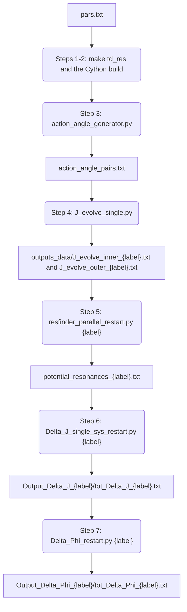

# gr-resonance-tools

Aloha mai kākou! gr-resonance-tools is our toolkit for computing the tidal resonances that a dynamical third body causes in an extreme mass ratio inspiral (EMRI) around a Kerr black hole. It is written in C, with Python (Cython) drivers. This README explains how to install the code and run the pipeline behind our papers ([arXiv:2207.07733](https://arxiv.org/abs/2207.07733) and [arXiv:2507.22260](https://arxiv.org/abs/2507.22260)). It is also the reference for the units, inputs and outputs of every step, so you can adapt the code to your own systems. If you have any questions, you can reach the developers here:

- Christopher Hirata (hirata.10@osu.edu)
- Makana Silva (msilva23@ucsc.edu)
- Harrison Blake-Goszyk (h.g.blake-goszyk@vanderbilt.edu)

Me ke aloha pumehana!

## Contents

- [What the code computes](#what-the-code-computes)
- [Requirements](#requirements)
- [Installation and build](#installation-and-build)
- [Quick start: a short test run](#quick-start-a-short-test-run)
- [Units and conventions](#units-and-conventions)
- [Configuration: pars.txt](#configuration-parstxt)
- [The pipeline step by step](#the-pipeline-step-by-step)
- [Output file reference](#output-file-reference)
- [Running on a cluster](#running-on-a-cluster)
- [Testing and debugging](#testing-and-debugging)
- [Python interface (gr_wrapper)](#python-interface-gr_wrapper)
- [Known issues and gotchas](#known-issues-and-gotchas)
- [Repository layout](#repository-layout)
- [Citing](#citing)

## What the code computes

An inner compact body (the "inner" or "First" body) inspirals into a supermassive black hole (SMBH) of mass M and spin a. A second body (the "outer" or "Second" body, the perturber) orbits the same black hole farther out. Each orbit is a Kerr geodesic labelled by its action variables J = (J_r, J_θ, J_φ). Its three fundamental frequencies are Ω = (Ω_r, Ω_θ, Ω_φ). Both orbits shrink slowly as they radiate gravitational waves.

A resonance happens when a harmonic of the inner orbit has the same frequency as a harmonic of the outer orbit:

$$
n_\mathrm{in}\,\Omega_{r,\mathrm{in}} + k_\mathrm{in}\,\Omega_{\theta,\mathrm{in}} + m\,\Omega_{\phi,\mathrm{in}}
= n_\mathrm{out}\,\Omega_{r,\mathrm{out}} + k_\mathrm{out}\,\Omega_{\theta,\mathrm{out}} + m\,\Omega_{\phi,\mathrm{out}} .
$$

The integers (n, k, m) label harmonics of the radial, polar and azimuthal motion, and both sides share the same m. As the inspiral passes through a resonance, the outer body's tidal field changes the inner body's actions by a small jump ΔJ. Silva & Hirata (2022) showed that ΔJ can be written in terms of the Teukolsky ψ₄ amplitudes at the horizon and at infinity, evaluated at the resonant frequency, so the code never needs the metric perturbation itself. The jump shifts the inner body's frequencies for the rest of the inspiral, which builds up a phase shift ΔΦ in the gravitational waveform.

The pipeline runs in seven steps. Step 0 is choosing the parameters. In the file names below, `{label}` is the integer system label (see [System labels](#system-labels)).



These papers describe the methods the code implements:

| arXiv | Paper | What it contributes here |
|---|---|---|
| [1010.0758](https://arxiv.org/abs/1010.0758) | Hirata 2011, *Lindblad resonance torques in relativistic discs I: Basic equations* (MNRAS 414, 3198) | Gauge-invariant resonance torques in stationary, axisymmetric spacetimes |
| [1010.0759](https://arxiv.org/abs/1010.0759) | Hirata 2011, *Lindblad resonance torques in relativistic discs II: Computation of resonance strengths* | Relates the torques to the gravitational waveforms of the perturber and a test particle; the origin of the CKerr core (Kerr geodesics and the Teukolsky mode solvers) |
| [1011.4987](https://arxiv.org/abs/1011.4987) | Hirata 2011, *Resonant recoil in extreme mass ratio binary black hole mergers* (PRD 83, 104024) | Resonance crossings during Kerr inspirals, and how resonant effects scale as the square root of the mass ratio |
| [2207.07733](https://arxiv.org/abs/2207.07733) | Silva & Hirata 2022, *Dynamical perturbations around an EMRI near resonance* | ΔJ from the ψ₄ amplitudes for generic Kerr orbits, in the static and dynamical limits |
| [2507.22260](https://arxiv.org/abs/2507.22260) | Silva, Blake-Goszyk & Hirata 2025, *Resonant interactions from dynamical perturbers on generic orbits around an EMRI* | The current pipeline: generic outer orbits, many resonances per system, a range of spins |

## Requirements

- **A C compiler with OpenMP.** On macOS, Apple's clang has no `-fopenmp`, so install GCC with Homebrew (`brew install gcc`), which provides `gcc-15`. The Makefile uses `CC = gcc-15`. On Linux or a cluster, change that line to `CC = gcc` (a commented-out version is just above it).
- **Perl 5**, to run `pars.pl`.
- **Python 3** with numpy, scipy, Cython and setuptools: `pip install numpy scipy cython setuptools`.
- **make.**

The code has been tested with macOS 26.6, Homebrew GCC 15.2.0, Perl 5.34.1, Python 3.10.8, numpy 1.24.2, scipy 1.15.3, Cython 0.29.32 and setuptools 65.5.0.

## Installation and build

Run every command from the repository root, the directory that holds the `Makefile`. The Python drivers use paths relative to it, such as `td_res_exe/` and `outputs_data/`.

```bash
git clone https://github.com/hirata10/gr-resonance-tools.git
cd gr-resonance-tools

make td_res          # pipeline executables, in td_res_exe/
make test            # optional: debug executables, in test_exe/

# Cython module gr_wrapper, used by steps 3 and 5
cd src/python
CC=gcc-15 python setup.py build_ext --inplace --force    # on Linux, use CC=gcc or leave CC unset
cd ../..
```

`make td_res` first runs `perl pars.pl`. That script turns `pars.txt` into two files: `src/C/globalpars_c.h`, with one `#define GLOBALPAR_<name> <value>` per parameter, and `src/python/globalpars.py`, with one `GLOBALPAR_<name> = <value>` per parameter. `make td_res` then builds four executables in `td_res_exe/`: `J_evolve_single_start`, `J_evolve_single_restart`, `Delta_J_single` and `Delta_Phi_single`. On macOS, the Cython build needs `CC=gcc-15` because `setup.py` compiles with `-fopenmp`.

**After you edit `pars.txt`, rebuild.** The parameter values are compiled into the executables. `make td_res` and `make test` notice the change and rebuild by themselves. The Cython module doesn't, so rerun the `setup.py` command with `--force`. Never edit `globalpars_c.h` or `globalpars.py` by hand. They are regenerated from `pars.txt` and aren't tracked by git.

**Compiler flags.** Everything is built with `-O2 -ffp-contract=off`, which gives bit-for-bit the same results as `-O0`. Pipeline executables are built with `-w`, which hides all warnings, and debug executables with `-Wall -g`. To step through the code in a debugger, rebuild with `make clean-test && make test OPTFLAGS=-O0`.

**Cleaning up:**

| Target | What it does |
|---|---|
| `make clean-td_res` | removes `td_res_exe/` |
| `make clean-test` | removes `test_exe/` |
| `make clean-data` | **moves** (doesn't delete) `outputs_data/`, `Output_Delta_J_*`, `Output_Delta_Phi_*`, `potential_resonances_*`, `precomputed_omegas_*`, `action_angle_pairs.txt` and the generated globals into `dump/dump-<timestamp>/` |
| `make clean` | all three |

## Quick start: a short test run

This runs every step for one small system. With these settings it took about 2.5 hours on a 10-core Mac. It tests the machinery but isn't a physical result: the J evolution covers only a short stretch of the inspiral, and the mode sums are heavily truncated.

First, set `pars.txt` to the values in the *Quick start* column of the [parameter table](#configuration-parstxt). Then:

```bash
# Steps 1-2: build
make td_res
(cd src/python && CC=gcc-15 python setup.py build_ext --inplace --force)

# Step 3: one system with known initial actions
#   columns: label, inner J_r J_theta J_phi, outer J_r J_theta J_phi
echo "1 2.322277 1.374186 3.374605 0.201801 7.29584 6.64418" > action_angle_pairs.txt

# Step 4: evolve both bodies. J_evolve_single.py needs at least 2 systems,
# so for one system run the two commands it would run.
#   arguments: J_r J_theta J_phi t0 n_time mu label inner|outer i_start
export OMP_NUM_THREADS=5
mkdir -p outputs_data
td_res_exe/J_evolve_single_start 2.322277 1.374186 3.374605 1.0 10 1e-05 1 inner 1 >> outputs_data/J_evolve_inner_1.txt &
td_res_exe/J_evolve_single_start 0.201801 7.29584 6.64418 1.0 3 1e-05 1 outer 1 >> outputs_data/J_evolve_outer_1.txt &
wait

# Step 5: find the resonances of system 1
python src/python/resfinder_parallel_restart.py 1

# Optional: keep 10 evenly spaced resonances, to make steps 6 and 7 short
cp potential_resonances_1.txt potential_resonances_1_full.txt
python -c "import numpy as np; L=open('potential_resonances_1_full.txt').read().splitlines(); open('potential_resonances_1.txt','w').write('\n'.join(L[i] for i in np.round(np.linspace(0,len(L)-1,10)).astype(int))+'\n')"

# Step 6: Delta J at each resonance
python src/python/Delta_J_single_sys_restart.py 1

# Step 7: Delta Phi at each resonance
python src/python/Delta_Phi_restart.py 1
```

The run this README is based on gave these results:

| Step | Wall time | What you should see |
|---|---|---|
| 4 | 64 min (2 processes × 5 threads) | `J_evolve_inner_1.txt` has rows i = 0 to 9 and ends at t ≈ 1.477 × 10⁵. Row 1 has J = (2.32218885170849, 1.36070812892435, 3.34010024030387). `J_evolve_outer_1.txt` has rows 0 to 2 and ends at t ≈ 6.39 × 10⁵. |
| 5 | 33 min (1 core) | 211 resonances in `potential_resonances_1.txt` before trimming |
| 6 | 28 min (5 processes; about 14 min per resonance) | 10 rows of 27 columns in `Output_Delta_J_1/tot_Delta_J_1.txt` |
| 7 | 30 min (5 processes) | 10 rows of 16 columns in `Output_Delta_Phi_1/tot_Delta_Phi_1.txt` |

Your ΔJ and ΔΦ values will differ from these, because step 6 draws a random resonant angle for each resonance. The checks in [Checks after a run](#checks-after-a-run) should pass every time.

## Units and conventions

### Units of each quantity

The code uses geometric units, G = c = 1, with lengths and times in units of the SMBH mass M. `pars.txt` sets `M 1.0`; keep it at 1. The spin is `astar` = a/M. The two bodies enter only through their mass ratios, `mu_inner` = μ_in/M and `mu_outer` = μ_out/M.

| Quantity | Names in the code and files | Units |
|---|---|---|
| Black hole mass | `M` | the unit of mass, of length (GM/c²) and of time (GM/c³) |
| Spin | `astar` | dimensionless, a/M |
| Mass ratios | `mu_inner`, `mu_outer` | dimensionless, μ/M |
| Actions | `J_r`, `J_theta`, `J_phi` | per unit mass of the body (J/μ); units of M |
| Energy | `E` (`EQL[0]`) | per unit body mass; dimensionless; E < 1 for bound orbits |
| Carter constant | `Q` (`EQL[1]`) | per unit body mass squared; units of M² |
| Axial angular momentum | `L` (`EQL[2]`) | per unit body mass; units of M; equal to J_φ |
| Radii | `ra`, `rp`, `sm_axis_*` | M (Boyer–Lindquist radius) |
| Inclination | `I` | radians |
| Frequencies | `Omega_r`, `Omega_theta`, `Omega_phi` | 1/M, with respect to Boyer–Lindquist coordinate time |
| Times | `t`, `dt`, `t0`, `t_res`, `t_scale` | M, in code time (see the next section) |
| Rate of change of a resonant frequency | `omega_dot_*`, `gamma` (Γ) | 1/M², in code time |
| Resonant angle | `theta_res` | radians |
| Jumps in the actions | `Delta_J_r`, `Delta_J_theta`, `Delta_J_phi` | like the actions, per unit mass of the inner body |
| Phase shifts | `Delta_Phi_*` | radians |

In the Newtonian limit, J_r + J_θ + |J_φ| = √(Ma), where a is the semi-major axis. `action_angle_generator.py` uses this relation to set the orbit sizes.

### Code time versus physical time

The self-force rate J̇ that drives the inspiral is computed for a unit mass ratio. `J2Jdot_component_openmp` has no mass-ratio argument, and the line that would rescale the time step by μ is commented out (around line 618 of `src/C/J2J_dot.c`). The physical rate of change of J/μ is proportional to μ, so the time that the integrator advances is the code time

$$
\tau = \mu_\mathrm{body}\, t_\mathrm{phys} ,
$$

and not the physical Boyer–Lindquist time. Every time-like quantity downstream inherits this:

| Quantity | Where it appears | Physical value |
|---|---|---|
| t, dt, t0 | J-evolution files; `potential_resonances` columns 2 and 31 | t_phys = t / μ_body |
| ω̇ and Γ | `potential_resonances` columns 3, 4 and 7; ΔJ column 8 | Γ_phys = μ · Γ |
| t_scale | ΔΦ column 11 | physical time = t_scale / μ_inner |

Actions, frequencies, (E, Q, L) and radii don't depend on the time unit, so they are unaffected. This has two consequences:

- Each body's time axis is scaled by its own mass ratio. The resonance finder evaluates both bodies on one time axis, so its results are consistent only when `mu_inner` = `mu_outer`.
- ΔJ and ΔΦ combine Γ and t_scale with the physical mass ratios, and their normalization is under review. See item 13 of [Known issues and gotchas](#known-issues-and-gotchas).

For example, the inner body in the quick start reaches τ = 1.477 × 10⁵ M after 9 steps. With μ_inner = 10⁻⁵, that is t_phys = τ/μ = 1.477 × 10¹⁰ M. For M = 10⁶ M☉, that is 7.28 × 10¹⁰ s, or about 2,300 years.

### Converting to physical units

GM☉/c³ = 4.925491 × 10⁻⁶ s and GM☉/c² = 1.476625 km. For a black hole of mass M:

- **time:** t[s] = t[M] × 4.925491 × 10⁻⁶ s × (M/M☉), after you have divided code time by μ;
- **length:** r[km] = r[M] × 1.476625 × (M/M☉);
- **frequency:** f[Hz] = Ω[1/M] / (2π × 4.925491 × 10⁻⁶ s × (M/M☉)).

For example, the quick-start inner orbit starts with Ω_φ = 3.667 × 10⁻³ /M. For M = 10⁶ M☉, that is f_φ = 1.19 × 10⁻⁴ Hz, which puts its m = 2 harmonic at 2.37 × 10⁻⁴ Hz, in the LISA band.

### Orbit parameterizations

The code moves between three descriptions of a bound Kerr geodesic:

| Description | Array layout | Converted by |
|---|---|---|
| Actions J = (J_r, J_θ, J_φ) | `J[0..2]` | `CKerr_J2EQL` (J to EQL) and `CKerr_EQL2J` (EQL to J), in `kerrtraj.c` |
| Constants of motion (E, Q, L) | `EQL[0] = E`, `EQL[1] = Q`, `EQL[2] = L` | as above |
| Orbit shape (r_a, r_p, I) | `ancillary[0] = I`, `ancillary[1] = r_p`, `ancillary[2] = r_a`, as filled in by `CKerr_EQL2J` | `ra_rp_I2EQL`, in `resonance_find.c` |

The frequencies come from `CKerr_Minverse(J)`, which returns the 3×3 matrix M⁻¹ as 9 numbers in row order, followed by `CKerr_Minv2Omega`.

- **Inclination:** I = π/2 − θ_min, where θ_min is the smallest polar angle the orbit reaches. For retrograde orbits (L < 0), I is replaced by π − I (line 203 of `kerrtraj.c`). So I = 0 is prograde equatorial, I = π/2 is polar, and I = π is retrograde equatorial.
- **Eccentricity:** e = (r_a − r_p)/(r_a + r_p).
- **Inner and outer:** the newer prompts in `calling.c` say "First body" and "Second body", but variable and file names still say inner and outer.

### Mode vectors and resonances

A harmonic of an orbit is labelled by integers (n, k, m) for the (r, θ, φ) motion, and its frequency is ω = nΩ_r + kΩ_θ + mΩ_φ. A resonance pairs an inner harmonic (n_in, k_in, m) with an outer harmonic (n_out, k_out, m). The two harmonics share m (the selection rule m_inner = m_outer), so the files store a single m.

`resfinder_parallel_restart.py` searches as follows:

- n_in, k_in, n_out and k_out each run over `range(N_min_Fourier, N_max_Fourier)`. That is Python's range, so the upper value is excluded: with −5 and 5, each runs from −5 to 4.
- For each combination, it computes the m that would satisfy the resonance condition at each time, m(t) = (n_out Ω_r,out + k_out Ω_θ,out − n_in Ω_r,in − k_in Ω_θ,in) / (Ω_φ,in − Ω_φ,out). It records a resonance wherever m(t) crosses an integer, provided that |m| ≤ N_max_Fourier.
- It keeps only combinations with k_in − k_out even.
- It keeps a combination only if gcd(n_in, n_out, k_in, k_out, m) is 1, or if it is 2 and (k_in − k_out)/2 is odd.
- Of each pair of mode vectors (N, −N), it keeps one, chosen by a lexicographic sign test on (m, n_in, n_out, k_in, k_out).

### System labels

Two different things are called a "system label":

- The **integer label** is column 0 of `action_angle_pairs.txt` (1, 2, …). It is the `{label}` in every output file name, such as `J_evolve_inner_{label}.txt`, `potential_resonances_{label}.txt` and `Output_Delta_J_{label}/`. It is also the command-line argument of steps 5 to 7.
- The **string** `system_label` in `pars.txt` (for example `"50_200-0.9"`) is a run name. Only the old `Delta_Phi_single.py` reads it.

## Configuration: pars.txt

`pars.txt` holds every run parameter. It follows three rules:

- Each line is `<name> <value>`, exactly two tokens separated by whitespace. A line with any other number of tokens is skipped without a warning, so don't put a comment on the same line as a value. Lines that start with `#` are comments.
- Each value is copied as is into C (`#define GLOBALPAR_<name> <value>`) and into Python (`GLOBALPAR_<name> = <value>`), so it must be valid in both languages. Write numbers plainly, and put strings in double quotes.
- The values are compiled in, so rebuild after any change (see [Installation and build](#installation-and-build)).

| Parameter | Quick start | Meaning | Used in |
|---|---|---|---|
| `M` | `1.0` | SMBH mass; the unit of mass, length and time. Keep it at 1. | every step |
| `astar` | `0.9` | SMBH spin a/M | every step |
| `mu_inner` | `0.00001` | inner body's mass ratio μ_in/M | step 4, which passes it to the J evolution but isn't affected by it ([Code time](#code-time-versus-physical-time)); step 5 (column 5) |
| `mu_outer` | `0.00001` | outer body's mass ratio μ_out/M | steps 4 and 5 as above (column 6); step 6, where ΔJ scales with it |
| `i_start_inner`, `i_start_outer` | `1`, `1` | index of the first RK4 step in a fresh run. Keep it at 1; restarts set their own. | step 4 |
| `n_time_inner`, `n_time_outer` | `10`, `3` | rows in each J-evolution file: row 0 (the initial J) plus n_time − 1 RK4 steps, unless the orbit plunges first | step 4 |
| `sm_axis_inner`, `sm_axis_outer` | `50`, `200` | orbit sizes in M for the random initial actions: the generator draws J with J_r + J_θ + J_φ = √(sm_axis). The Kerr orbit's (r_a + r_p)/2 comes out smaller: 44.5 instead of 50 for the quick-start inner orbit. | step 3 |
| `N_sys` | `1` | number of systems (inner–outer pairs) to generate | step 3 |
| `N_res` | `5` | ΔJ sums the harmonics j·(n, k, m) of each resonance for j = −N_res to N_res | step 6 |
| `nl_res` | `4` | number of ℓ modes for each harmonic in ΔJ | step 6 |
| `N_min_Fourier`, `N_max_Fourier` | `-5`, `5` | resfinder searches N_min_Fourier ≤ n_in, k_in, n_out, k_out < N_max_Fourier, with \|m\| ≤ N_max_Fourier | step 5 |
| `t0` | `1.0` | initial time of the J evolution, in code time | step 4 |
| `nl_self` | `2` | number of ℓ modes for each (n, k, m) in the self-force J̇ | steps 4 and 7 |
| `nmax`, `kmax`, `mmax` | `2`, `2`, `2` | the self-force J̇ sums over \|n\| ≤ nmax, \|k\| ≤ kmax and \|m\| ≤ mmax | steps 4 and 7 |
| `Nr_self`, `Nt_self` | `28`, `14` | radial and polar grid sizes of the mode integrals (`CKerr_RadialFunc`) in the step 4 self-force | step 4 |
| `chunk_size` | `5` | how many jobs a driver starts at once: systems in step 4 (two processes each), resonances in steps 6 and 7 (also the number of rows in each chunk file) | steps 4, 6 and 7 |
| `tgrid_resfinder` | `100` | target number of points on resfinder's time grid | step 5 |
| `system_label` | `"50_200-0.9"` | run name; only the old `Delta_Phi_single.py` reads it | none |

The quick-start values are small, for testing. A production run differs in three ways:
- `n_time_*` must cover the part of the inspiral you care about.
- The outer run must span the inner run's time range.
- The self-force truncation (`nl_self`, `nmax`, `kmax`, `mmax`) must be large enough for J̇ to converge. Eccentric orbits need many more radial harmonics. Check convergence with `test_exe/J2J_DOT_SF_OMP` before a production run.

Steps 6 and 7 don't use `Nr_self` and `Nt_self`. They use fixed grids: 42 × 42 for ΔJ (`Delta_J.c`) and 28 × 14 for the self-force behind t_scale (`J_dot.c`).

## The pipeline step by step

Run each step's command from the repository root. Steps 5 to 7 take the integer system label as their argument. The columns of every file are listed in [Output file reference](#output-file-reference).

### Step 0: choose the parameters

Edit `pars.txt`; see [Configuration: pars.txt](#configuration-parstxt).

### Steps 1 and 2: build

`make td_res` builds the four pipeline executables in `td_res_exe/`. The `setup.py` command builds the Cython module `gr_wrapper`, which steps 3 and 5 import; see [Installation and build](#installation-and-build). Run the drivers as `python src/python/<script>.py`, so that Python finds `gr_wrapper` and `globalpars.py` in the script's directory.

### Step 3: draw the initial actions

```bash
python src/python/action_angle_generator.py
```

- **Inputs:** `M`, `astar`, `sm_axis_inner`, `sm_axis_outer` and `N_sys`.
- **Output:** `action_angle_pairs.txt`, with one row per system: the label and the six initial actions.
- **What it does:** for each body, it draws random actions with J_r + J_θ + J_φ = √(sm_axis) and J_φ ≥ 0 (prograde orbits). It keeps a draw only if all four of these hold:
  - both orbits are bound (E < 1);
  - the outer pericenter is at least twice the inner apocenter, so the orbits stay well apart;
  - both pericenters lie outside the horizon r₊ = M + √(M² − a²);
  - both eccentricities are at most 0.8, since higher eccentricities need more radial resolution.
- **Notes:** the random draws are unseeded, so every run gives new systems. You can also write the file by hand, as in the quick start.

### Step 4: evolve the actions

```bash
export OMP_NUM_THREADS=4      # OpenMP threads per process
python src/python/J_evolve_single.py
```

- **Inputs:** `action_angle_pairs.txt`; `t0`, `n_time_*`, `i_start_*`, `mu_*` and `chunk_size`. Compiled in: `M`, `astar`, `nl_self`, `nmax`, `kmax`, `mmax`, `Nr_self` and `Nt_self`.
- **Outputs:** `outputs_data/J_evolve_inner_{label}.txt` and `outputs_data/J_evolve_outer_{label}.txt` for each system.
- **What it does:** for each system, it runs `td_res_exe/J_evolve_single_start` once for each body.
  - **Integration:** dJ/dτ = J̇_sf(J), with fourth-order Runge–Kutta and the adaptive step dt = 0.01 × min_i |J_i / J̇_i| (`J2J_dot.c`).
  - **The self-force J̇_sf:** the radiation-reaction rate of change of the actions. It comes from the Teukolsky amplitudes at infinity and at the horizon, summed over the modes that `nl_self`, `nmax`, `kmax` and `mmax` select. `J_dot.c` cites Eq. (12) of [arXiv:1905.00030v2](https://arxiv.org/abs/1905.00030v2) for it.
  - **Output:** after each step, it writes a row with t, J, Ω and dt.
- **Plunges:** the run writes the line `It plunged.` and stops if any of these happen:
  - the new J is NaN;
  - a mode calculation fails;
  - J no longer describes a bound orbit.
- **Executable arguments:** `J_r J_theta J_phi t_start n_time mu label inner|outer i_start`. The output goes to standard output, and the driver appends it to the file. `J_evolve_single_start` first prints a 9-line header and row 0 (the initial J). `J_evolve_single_restart` takes the same arguments and prints rows only.
- **Restarts:** rerun the driver. If a file exists and its last line is a valid row, the driver continues from that row with `J_evolve_single_restart`. It skips a file that ends with `It plunged.`. It also stops extending a body once t ≥ 10⁶ (hard-coded) or once the file has n_time rows. To extend a run, raise `n_time_*` and rerun.
- **Parallelism:** the driver starts 2 × `chunk_size` processes at a time, inner and outer for each system. Each process uses `OMP_NUM_THREADS` OpenMP threads, or every core if that is unset. Keep 2 × `chunk_size` × `OMP_NUM_THREADS` within your core count.
- **Cost:** this is the most expensive step. In the quick start, 9 inner steps took 64 minutes with 5 threads.

### Step 5: find the resonances

```bash
python src/python/resfinder_parallel_restart.py {label}
```

- **Inputs:** `outputs_data/J_evolve_inner_{label}.txt` and `J_evolve_outer_{label}.txt`, read after skipping the 9 header lines; `M`, `astar`, `mu_*`, `N_min_Fourier`, `N_max_Fourier` and `tgrid_resfinder`.
- **Outputs:** `potential_resonances_{label}.txt`, with one row per resonance crossing, and `precomputed_omegas_{label}.txt`, a cache of both bodies' frequencies on the time grid.
- **What it does:**
  1. Fits cubic splines to each body's J(t).
  2. Builds a time grid by splitting each interval of the inner file into equal parts, giving about `tgrid_resfinder` points, and computes both bodies' Ω at each point through `gr_wrapper`.
  3. Searches the mode combinations described in [Mode vectors and resonances](#mode-vectors-and-resonances).
  4. At each crossing:
     - It estimates each body's ω̇ by finite difference across the grid interval, and sets Γ = ω̇_out − ω̇_in.
     - It extrapolates linearly to the crossing time, t_res = t_i − (ω_out − ω_in)(t_i)/Γ.
     - It records both bodies' J, Ω and (I, r_p, r_a) at t_res.
     - Its last column, Δω = ω_out − ω_in at t_res, should be close to zero.
- **Notes:** the outer evolution must cover the inner evolution's time range, because the splines extrapolate silently. A crossing in the first grid interval is ignored.
- **Restarts:** rerun with the same label. It skips mode combinations that are already in the output file and reuses the frequency cache. It exits with code 1 five minutes before a 16-hour limit. If you change the J evolution, `tgrid_resfinder` or the Fourier range, move both output files away first; otherwise the stale cache gets reused.
- **Cost:** one core. In the quick start, 5,000 mode combinations on 100 grid points took 33 minutes and found 211 resonances.

### Step 6: compute Delta J at each resonance

```bash
python src/python/Delta_J_single_sys_restart.py {label}
```

- **Inputs:** `potential_resonances_{label}.txt` and `chunk_size`. Compiled in: `M`, `astar`, `N_res` and `nl_res`.
- **Outputs:**
  - `Output_Delta_J_{label}/Delta_J_{label}_log_<T>_<c>.txt`, one file per chunk of `chunk_size` resonances. T is the number of chunks, and c runs from 1 to T.
  - `Output_Delta_J_{label}/tot_Delta_J_{label}.txt`, with all chunks combined and sorted by resonance label.
- **What it does:** for each resonance, it draws a resonant angle θ_res uniformly in [0, 2π) and runs `td_res_exe/Delta_J_single`.
  - **The calculation:** `Delta_J_tidal2` in `Delta_J.c` computes the jump ΔJ in the inner body's actions, per unit inner-body mass, from the Teukolsky amplitudes of both orbits at the resonant frequency.
  - **The sum:** it runs over the harmonics j·(n, k, m) for j = −N_res to N_res, with `nl_res` ℓ modes each. It skips j = 0 and any harmonic with |j·n| or |j·k| above 20.
  - **Scaling:** ΔJ is proportional to `mu_outer` and to 1/√|Γ|, and it is parallel to (n_in, k_in, m).
- **Executable arguments (29):** `n_in n_out k_in k_out m m ra_in rp_in I_in ra_out rp_out I_out Gamma theta_res mu_outer system_label res_label Omega_in(3) Omega_out(3) J_in(3) J_out(3)`. Note the order of the first four.
- **Restarts:** rerun. The driver skips chunk files that already have all their rows, and clears and recomputes incomplete ones.
- **Parallelism and cost:** `chunk_size` processes run at a time, one thread each. The driver's polling loop keeps one more core busy. Each resonance took about 14 minutes on one core.

### Step 7: compute Delta Phi at each resonance

```bash
python src/python/Delta_Phi_restart.py {label}
```

- **Inputs:** `Output_Delta_J_{label}/tot_Delta_J_{label}.txt`; `chunk_size`, `M` and `astar`. Compiled in: `nl_self`, `nmax`, `kmax` and `mmax`.
- **Outputs:** `Output_Delta_Phi_{label}/Delta_Phi_{label}_log_<T>_<c>.txt` for each chunk, and `Output_Delta_Phi_{label}/tot_Delta_Phi_{label}.txt` with all chunks combined.
- **What it does:** for each resonance, it runs `td_res_exe/Delta_Phi_single` (`kerrphase.c`), which does four things:
  1. It converts the inner body's J at resonance to (E, Q, L).
  2. It computes ∂Ω/∂J analytically from contour integrals.
  3. It estimates the inspiral time after the resonance from the self-force J̇ as t_scale = (1/8) |ΣJ_i / ΣJ̇_i|. The factor 1/8 makes this exact for a Newtonian circular inspiral, where J ∝ (t_c − t)^(1/8).
  4. It computes the phase shifts:

$$
\Delta\Phi_i = t_\mathrm{scale} \sum_k \frac{\partial \Omega_i}{\partial J_k}\, \Delta J_k \quad (i = r, \theta, \phi),
\qquad
\Delta\Phi_\mathrm{tot} = n\,\Delta\Phi_r + k\,\Delta\Phi_\theta + m\,\Delta\Phi_\phi .
$$

- **Executable arguments (13):** `astar J_r J_theta J_phi M dJ_r dJ_theta dJ_phi n k m res_label system_label`.
- **Restarts and parallelism:** as in step 6. In the quick start, each resonance took about 15 minutes, mostly in the self-force J̇ for t_scale.
- **Don't use `Delta_Phi_single.py`.** It is an older driver that doesn't run as is; see [Known issues and gotchas](#known-issues-and-gotchas).

## Output file reference

All files are plain text with whitespace-separated columns. Columns are numbered from 0, as in numpy and in the drivers' `row[i]`. "Code time" means τ = μ·t; see [Code time versus physical time](#code-time-versus-physical-time).

<details>
<summary><code>action_angle_pairs.txt</code>: 7 columns, one row per system (step 3)</summary>

| Col | Name | Units | Meaning |
|---|---|---|---|
| 0 | label | — | integer system label |
| 1 | J_r_inner | M | inner body's initial actions, per unit inner-body mass |
| 2 | J_theta_inner | M | |
| 3 | J_phi_inner | M | |
| 4 | J_r_outer | M | outer body's initial actions, per unit outer-body mass |
| 5 | J_theta_outer | M | |
| 6 | J_phi_outer | M | |

</details>

<details>
<summary><code>outputs_data/J_evolve_{inner,outer}_{label}.txt</code>: 9 header lines, then 9 columns per step (step 4)</summary>

The file starts with 9 header lines. Seven of them echo the run: the argument count, n_time, t0, μ, the black hole mass and spin, the initial J, and the label and body. Then come the column names and a line of dashes. After the header there is one tab-separated row per step. Restarts append rows without a header. If the orbit plunged, the last line is `It plunged.`. The file writes t with 6 decimals, J and Ω with 15 significant digits, and dt with 6 significant digits.

| Col | Name | Units | Meaning |
|---|---|---|---|
| 0 | i | — | step index; row 0 is the initial J |
| 1 | t | M, code time | time at this step |
| 2 | J_r | M | actions, per unit body mass |
| 3 | J_theta | M | |
| 4 | J_phi | M | |
| 5 | Omega_r | 1/M | frequencies |
| 6 | Omega_theta | 1/M | |
| 7 | Omega_phi | 1/M | |
| 8 | dt | M, code time | the step that led to this row; 0 in row 0 |

</details>

<details>
<summary><code>precomputed_omegas_{label}.txt</code>: 8 columns on resfinder's time grid (step 5)</summary>

This is a cache that lets resfinder restart. It has one header line starting with `#`, and its values are written with `%.12e`.

| Col | Name | Units | Meaning |
|---|---|---|---|
| 0 | i | — | grid index |
| 1 | t | M, code time | grid time |
| 2 | om_in_r | 1/M | inner body's Ω, from the spline-interpolated J |
| 3 | om_in_theta | 1/M | |
| 4 | om_in_phi | 1/M | |
| 5 | om_out_r | 1/M | outer body's Ω |
| 6 | om_out_theta | 1/M | |
| 7 | om_out_phi | 1/M | |

</details>

<details>
<summary><code>potential_resonances_{label}.txt</code>: 33 columns, one row per resonance crossing (step 5)</summary>

Space-separated, at full double precision.

| Col | Name | Units | Meaning |
|---|---|---|---|
| 0 | res_label | — | resonance number within the file (1, 2, …) |
| 1 | system_label | — | integer system label |
| 2 | t_grid | M, code time | start of the grid interval that contains the crossing |
| 3 | omega_dot_inner | 1/M², code time | dω_in/dτ, where ω_in = n_in Ω_r,in + k_in Ω_θ,in + m Ω_φ,in |
| 4 | omega_dot_outer | 1/M², code time | dω_out/dτ |
| 5 | mu_inner | — | from `pars.txt` |
| 6 | mu_outer | — | from `pars.txt` |
| 7 | gamma | 1/M², code time | Γ = ω̇_out − ω̇_in |
| 8 | m | — | shared azimuthal number |
| 9 | n_inner | — | |
| 10 | k_inner | — | |
| 11 | n_outer | — | |
| 12 | k_outer | — | |
| 13 | J_r_inner | M | inner body's actions at t_res |
| 14 | J_theta_inner | M | |
| 15 | J_phi_inner | M | |
| 16 | J_r_outer | M | outer body's actions at t_res |
| 17 | J_theta_outer | M | |
| 18 | J_phi_outer | M | |
| 19 | Omega_r_inner | 1/M | inner body's frequencies at t_res |
| 20 | Omega_theta_inner | 1/M | |
| 21 | Omega_phi_inner | 1/M | |
| 22 | Omega_r_outer | 1/M | outer body's frequencies at t_res |
| 23 | Omega_theta_outer | 1/M | |
| 24 | Omega_phi_outer | 1/M | |
| 25 | I_inner | rad | inner orbit's inclination at t_res |
| 26 | rp_inner | M | inner pericenter |
| 27 | ra_inner | M | inner apocenter |
| 28 | I_outer | rad | outer orbit's inclination at t_res |
| 29 | rp_outer | M | outer pericenter |
| 30 | ra_outer | M | outer apocenter |
| 31 | t_res | M, code time | crossing time, t_grid − (ω_out − ω_in)/Γ |
| 32 | Delta_omega | 1/M | ω_out − ω_in at t_res; should be close to 0 |

</details>

<details>
<summary><code>Output_Delta_J_{label}/tot_Delta_J_{label}.txt</code> and its chunk files: 27 columns, one row per resonance (step 6)</summary>

The chunk files `Delta_J_{label}_log_<T>_<c>.txt` are tab-separated and written with `%lg`, which keeps 6 significant digits. `tot_Delta_J_{label}.txt` combines them, sorted by resonance label. It is space-separated and written with `%g`.

| Col | Name | Units | Meaning |
|---|---|---|---|
| 0 | res_label | — | column 0 of `potential_resonances` |
| 1 | system_label | — | integer system label |
| 2 | n_inner | — | |
| 3 | k_inner | — | |
| 4 | n_outer | — | |
| 5 | k_outer | — | |
| 6 | m | — | |
| 7 | theta_res | rad | the resonant angle used, drawn at random |
| 8 | Gamma | 1/M², code time | column 7 of `potential_resonances` |
| 9 | Omega_r_inner | 1/M | frequencies at resonance |
| 10 | Omega_theta_inner | 1/M | |
| 11 | Omega_phi_inner | 1/M | |
| 12 | Omega_r_outer | 1/M | |
| 13 | Omega_theta_outer | 1/M | |
| 14 | Omega_phi_outer | 1/M | |
| 15 | J_r_inner | M | actions at resonance |
| 16 | J_theta_inner | M | |
| 17 | J_phi_inner | M | |
| 18 | J_r_outer | M | |
| 19 | J_theta_outer | M | |
| 20 | J_phi_outer | M | |
| 21 | Delta_J_r | M | jump in the inner body's actions across the resonance, per unit inner-body mass |
| 22 | Delta_J_theta | M | |
| 23 | Delta_J_phi | M | |
| 24 | Delta_J_r / J_r | — | relative jumps |
| 25 | Delta_J_theta / J_theta | — | |
| 26 | Delta_J_phi / J_phi | — | |

</details>

<details>
<summary><code>Output_Delta_Phi_{label}/tot_Delta_Phi_{label}.txt</code> and its chunk files: 16 columns, one row per resonance (step 7)</summary>

The chunk files `Delta_Phi_{label}_log_<T>_<c>.txt` are tab-separated and written with `%e`. `tot_Delta_Phi_{label}.txt` combines them, sorted by resonance label, and is written with `%g`.

| Col | Name | Units | Meaning |
|---|---|---|---|
| 0 | res_label | — | |
| 1 | system_label | — | integer system label |
| 2 | n | — | the inner body's mode |
| 3 | k | — | |
| 4 | m | — | |
| 5 | J_r | M | inner body's actions at resonance |
| 6 | J_theta | M | |
| 7 | J_phi | M | |
| 8 | E | — | inner body's energy at resonance, per unit mass |
| 9 | Q | M² | Carter constant |
| 10 | L | M | axial angular momentum |
| 11 | t_scale | M, code time | inspiral time after the resonance, (1/8) \|ΣJ / ΣJ̇\| |
| 12 | Delta_Phi_r | rad | |
| 13 | Delta_Phi_theta | rad | |
| 14 | Delta_Phi_phi | rad | |
| 15 | Delta_Phi_tot | rad | n ΔΦ_r + k ΔΦ_θ + m ΔΦ_φ |

</details>

## Running on a cluster

Production runs used SLURM. Some things to know:

- **Wall-time limits.** Each driver is set up for a 16-hour wall-time limit:
  - `J_evolve_single.py`, `Delta_J_single_sys_restart.py` and `Delta_Phi_restart.py` stop their subprocesses and exit with code 137 after 15 h 55 min.
  - The ΔJ and ΔΦ drivers also won't start a new chunk if less than 30 minutes remain.
  - `resfinder_parallel_restart.py` exits with code 1 at 15 h 55 min.

  Rerunning the same command resumes the work. To change the limits, edit `WALLTIME_LIMIT`, `walltime_limit_sec` or `WALL_TIME_SECONDS` in the drivers.
- **SIGTERM.** `J_evolve_single.py` and `Delta_Phi_restart.py` also catch SIGTERM, which SLURM sends at the time limit, and stop their subprocesses.
- **The `slurm/` scripts are out of date.** They are templates from earlier runs and have three problems:
  - they compile with raw `gcc` commands and old flags (`IS_RK4_J_DOT`, `IS_RK4_J_DOT_norestart`);
  - they use paths relative to `src/C`;
  - they call `organize_*.py` scripts that aren't in the repository.

  Use them as a starting point, but build with the Makefile, with `CC = gcc`.

## Testing and debugging

There is no automated test suite. To check a change, build the debug executables and compare their output with a build from before the change.

```bash
make test                  # all 13 tools, in test_exe/, built with -Wall -g
make test_exe/J2EQL        # or a single tool
```

For example:

```
$ test_exe/J2EQL 2.322277 1.374186 3.374605 1.0 0.9
I, rp, ra, eccentricity: 0.780312587018366 11.1313972911425 77.8058334260688 0.74967969653707
EQL: 0.988913755705662 11.1674772327167 3.374605
```

### Debug executables

The OpenMP tools take two thread counts. `omp_threads` is the number of OpenMP threads. `veclib_threads` sets `VECLIB_MAXIMUM_THREADS` for Apple's Accelerate library; other systems ignore it, but it must still be at least 1.

| Executable | What it does | Arguments |
|---|---|---|
| `J2EQL` | converts actions to (E, Q, L) and (I, r_p, r_a, e) | `J_r J_theta J_phi M astar` |
| `ORBIT2J` | converts an orbit to J, (E, Q, L) and Ω, and checks the round trip; r_a = r_p = I = 0 means a circular equatorial orbit of the given radius | `ra rp I radius M astar`, or the same 6 numbers on standard input |
| `CHECK_RES_COND` | prints both orbits, their frequencies and the mismatch ω_out − ω_in for one mode pair | `J_in(3) J_out(3) n_in k_in m_in n_out k_out m_out M astar` |
| `J2J_DOT_SF` | self-force J̇ and (Ė, Q̇, L̇) of one orbit, serial | `J(3) nmax kmax mmax nl_self M astar omp_threads veclib_threads Nr Nt` |
| `J2J_DOT_SF_OMP` | the same with OpenMP; this is the version step 4 uses | as `J2J_DOT_SF` |
| `J2J_DOT_TIDAL_SINGLE` | tidal J̇ of the inner body at one resonant angle, serial | `J_in(3) J_out(3) n_in k_in m_in n_out k_out m_out angle M astar mu_in mu_out omp_threads veclib_threads` |
| `J2J_DOT_TIDAL_SINGLE_OMP` | the same with OpenMP; also prints the outer body's tidal J̇ | as `J2J_DOT_TIDAL_SINGLE` |
| `J2J_DOT_TIDAL_LOOP` | tidal J̇ of the inner body over a range of resonant angles | as `J2J_DOT_TIDAL_SINGLE` |
| `DELTA_EQL` | the change in (E, Q, L), and the orbit before and after a jump ΔJ | `dJ_r dJ_theta dJ_phi J_r J_theta J_phi M astar` |
| `GAMMA_EQ17` | Γ from Eq. (17) of arXiv:2207.07733 with the analytic ∂Ω/∂J, compared with a finite-difference estimate | `J_in(3) J_out(3) n_in k_in n_out k_out m M astar nl_self nmax kmax mmax Nr Nt omp_threads veclib_threads`, optionally followed by `Jdot_in(3) Jdot_out(3)`; or no arguments, to read them from standard input |
| `DELTA_PHI_IMAG` | a `Delta_Phi_single` that prints the contour integrals with their \|Im/Re\| ratios, dJ/dEQL, dM/dJ and dΩ/dJ, then stops before ΔΦ | the 13 arguments of `Delta_Phi_single` (step 7) |
| `RESFIND_APO` | finds, by bisection, the inner apocenter that puts the inner orbit in resonance with a circular equatorial outer orbit | prompts for its inputs |
| `RESFIND_APO_GENERIC` | the same, for a generic outer orbit | prompts for its inputs |

### Checks after a run

Four checks should pass after every run:

- No J-evolution file ends with `It plunged.`. Running `grep -l "It plunged" outputs_data/*.txt` should print nothing.
- The resonance condition holds at each crossing: |Δω/ω| is small.
- Each ΔJ is parallel to (n_in, k_in, m).
- Every ΔΦ row has ΔΦ_tot = n ΔΦ_r + k ΔΦ_θ + m ΔΦ_φ.

This script checks the last three for system 1. Run it from the repository root.

```python
import numpy as np
label = 1

# Resonance condition: |Delta_omega / omega| at each crossing
r = np.loadtxt(f"potential_resonances_{label}.txt", ndmin=2)
omega_in = r[:, 9] * r[:, 19] + r[:, 10] * r[:, 20] + r[:, 8] * r[:, 21]
print("max |Delta_omega / omega|:", np.max(np.abs(r[:, 32] / omega_in)))

# Delta J is parallel to (n_in, k_in, m)
d = np.loadtxt(f"Output_Delta_J_{label}/tot_Delta_J_{label}.txt", ndmin=2)
N, dJ = d[:, [2, 3, 6]], d[:, 21:24]
sin_angle = np.linalg.norm(np.cross(N, dJ), axis=1) / (np.linalg.norm(N, axis=1) * np.linalg.norm(dJ, axis=1))
print("max sin(angle between Delta J and (n, k, m)):", sin_angle.max())

# Delta Phi total = n dPhi_r + k dPhi_theta + m dPhi_phi
p = np.loadtxt(f"Output_Delta_Phi_{label}/tot_Delta_Phi_{label}.txt", ndmin=2)
tot = p[:, 2] * p[:, 12] + p[:, 3] * p[:, 13] + p[:, 4] * p[:, 14]
print("max relative error of the Delta Phi total:", np.max(np.abs(tot - p[:, 15]) / np.abs(p[:, 15])))
```

For the quick start, all three numbers were below 2 × 10⁻⁵. The last two are limited by the 6 significant digits of the files.

## Python interface (gr_wrapper)

The Cython module `gr_wrapper` makes 49 of the C functions callable from Python, under lowercase names: `CKerr_J2EQL` becomes `ckerr_j2eql`. You build it in step 2. It lives in `src/python/`, so run your script from there or add that directory to `sys.path`.

```python
from gr_wrapper import ckerr_j2eql, ckerr_eql2j, ckerr_minverse, ckerr_minv2omega

M, astar = 1.0, 0.9
J = [2.322277, 1.374186, 3.374605]                     # (J_r, J_theta, J_phi), per unit body mass
flag, EQL = ckerr_j2eql(J, M, astar)                   # EQL = (E, Q, L)
flag, J_back, anc = ckerr_eql2j(list(EQL), M, astar)   # anc = (I, r_p, r_a)
flag, Minv = ckerr_minverse(J, M, astar)               # the 3x3 matrix M^-1, as 9 numbers
Omega = ckerr_minv2omega(Minv)                         # (Omega_r, Omega_theta, Omega_phi)
```

The results are:
- EQL = (0.988914, 11.1675, 3.374605);
- anc = (0.780313, 11.1314, 77.8058);
- Ω = (3.15433 × 10⁻³, 3.59586 × 10⁻³, 3.66718 × 10⁻³).

This Ω is the same as row 0 of `J_evolve_inner_1.txt` in the quick start. `ckerr_j2eql`, `ckerr_eql2j` and `ckerr_minverse` each return the C function's flag first, where 1 means success.

The wrapped functions, grouped by purpose:

| Group | Functions |
|---|---|
| Orbits, actions and frequencies | `ckerr_j2eql`, `ckerr_eql2j`, `ckerr_deqdj`, `ckerr_minverse`, `ckerr_minversend`, `ckerr_minv2omega`, `ckerr_emin`, `ckerr_emax`, `ckerr_qljr2e`, `ckerr_torusorigin`, `ckerr_flowvectors`, `ckerr_angleflowvectors`, `ckerr_xu2intt`, `ckerr_getdata_circeq`, `ckerr_findisco`, `ckerr_findeql_irr`, `ckerr_findeql_ircirc`, `ckerr_findrescirc` |
| Teukolsky modes and gravitational-wave emission | `ckerr_yslm`, `ckerr_sbcoef`, `ckerr_sbcoefn`, `ckerr_spheroidalyslm`, `ckerr_r2rstar`, `ckerr_rstar2r`, `ckerr_vr`, `ckerr_ingoingr1`, `ckerr_radial2nd`, `ckerr_radialrkstep`, `ckerr_radialmidptstep`, `ckerr_radialmidptextrstep`, `ckerr_outgoingr3`, `ckerr_radialstepmany`, `ckerr_gwscatmatrix`, `ckerr_radialfunc`, `ckerr_horizonfluxnorm`, `ckerr_quantaemitted` |
| Lindblad resonances ([arXiv:1010.0759](https://arxiv.org/abs/1010.0759)) | `ckerr_findlindbladresonance`, `ckerr_lindbladresonancestrength` |
| Resonance search | `ra_rp_i2eql`, `omega_outer_direct`, `ra_rp_i2omega_outercirc`, `ra_rp_i2omega_generic`, `find_resonance_apo_outercirc` |
| Rates of change | `j_dot_selfforce`, `j_dot_tidal`, `j_dot_phi_kepler`, `omegadot`, `j2jdot`, `j2jdot_component` |

The arguments follow the C prototypes in `src/C/CKerr.h`. The wrappers in `src/python/gr_wrapper.pyx` show how arrays go in and come back out.

Several functions aren't wrapped:
- `Delta_J_tidal2` (step 6);
- the RK4 integrators;
- the OpenMP J̇ routines (`J_dot_selfforce_openmp`, `J_dot_tidal_openmp` and `J2Jdot_component_openmp`);
- the `kerrphase.c` functions (step 7). `setup.py` compiles `kerrphase.c`, but nothing wraps it yet.

To wrap a C function:
1. Declare it in `gr_wrapper.pxd`.
2. Add a `def` to `gr_wrapper.pyx`.
3. If its source file is new, add the file to `files` in `setup.py`.
4. Rebuild with `--force`.

## Known issues and gotchas

1. **`J_evolve_single.py` fails when `N_sys = 1`**, with `IndexError: invalid index to scalar variable`, because numpy's `loadtxt` returns a 1-D array for a one-line file. Use two or more systems, or run the two executables directly as in the quick start.
2. **A plunge breaks step 5.** If an orbit plunges, its J-evolution file ends with `It plunged.`, and resfinder's `np.loadtxt` stops with `ValueError: the number of columns changed from 9 to 2`. The rows before that line are valid, so delete the line, or leave the system out.
3. **`Delta_Phi_single.py` doesn't run as is**, for four reasons:
   - it reads `GLOBALPAR_chunk_size_phi`, which `pars.txt` doesn't define;
   - it takes the label from `pars.txt` instead of the command line;
   - it looks for `tot_Delta_J_*.txt` in the repository root;
   - it calls `./Delta_Phi_single` instead of `td_res_exe/Delta_Phi_single`.

   Use `Delta_Phi_restart.py` instead.
4. **The outer run must cover the inner run's time range.** resfinder evaluates both bodies on the inner body's time grid with cubic splines, which extrapolate silently past the end of the outer data. Choose `n_time_outer` so that the outer file's last t is at least the inner file's.
5. **The two time axes only agree when `mu_inner` = `mu_outer`**; see [Code time versus physical time](#code-time-versus-physical-time).
6. **resfinder can reuse stale files.** It reuses `precomputed_omegas_{label}.txt` and skips resonances that are already in `potential_resonances_{label}.txt`. If you rerun step 4 or change `tgrid_resfinder` or the Fourier range, move both files away before rerunning step 5.
7. **The random draws are unseeded.** `action_angle_generator.py` and the θ_res draw in step 6 use Python's `random` without a seed, so reruns differ. The θ_res used for each resonance is saved in column 7 of the ΔJ files. To reproduce a row, pass it as the 14th argument of `Delta_J_single`.
8. **Steps 6 and 7 pass data at limited precision.** `Delta_J_single` writes J and ΔJ with 6 significant digits, and step 7 reads them from that file.
9. **`make` doesn't rebuild the Cython module.** After changing `pars.txt` or the C code, rerun the `setup.py` command with `--force`.
10. **The ΔJ and ΔΦ drivers keep a core busy.** They poll their subprocesses in a loop that never sleeps.
11. **Restarts of step 4 stop at t = 10⁶** (code time), whatever `n_time_*` says. The limit is hard-coded in `J_evolve_single.py`.
12. **`make clean-data` moves files rather than deleting them**, so `dump/` keeps growing. Empty it now and then.
13. **The normalization of ΔJ and ΔΦ is under review.** The Γ that resfinder writes (column 7) is in code-time units. `Delta_J_single` combines it with the physical `mu_outer`: the ΔJ sum in `Delta_J.c` is proportional to `mu_outer` · √(2π / \|jΓ\|). Likewise, step 7 multiplies by t_scale, which is also in code-time units. The developers are checking whether ΔJ and ΔΦ need a further factor of the mass ratio. Until this note is removed, treat the absolute values of ΔJ and ΔΦ with care.

## Repository layout

```
pars.txt            run configuration: edit this
pars.pl             turns pars.txt into src/C/globalpars_c.h and src/python/globalpars.py
Makefile            builds td_res_exe/ (pipeline) and test_exe/ (debug tools)
slurm/              SLURM job templates (out of date; see "Running on a cluster")
src/C/
  CKerr.h           prototypes of all the C functions
  kerrtraj.c        Kerr geodesics: J <-> (E, Q, L), frequencies, ISCO, circular orbits, torus flow
  kerrmode.c        Teukolsky angular (spin-weighted spheroidal) and radial mode functions, scattering matrix
  kerrgwem.c        gravitational-wave emission from geodesic sources: mode amplitudes, fluxes to infinity and the horizon
  resonance_find.c  (ra, rp, I) -> (E, Q, L), radial potential, bisection for resonant apocenters
  J_dot.c           self-force and tidal J_dot, serial and OpenMP
  J2J_dot.c         J -> J_dot wrappers and the RK4 evolution
  Gamma.c           rate of change Gamma of a resonant frequency
  Delta_J.c         Delta J across a resonance (step 6 uses Delta_J_tidal2)
  kerrphase.c       dOmega/dJ, t_scale and Delta Phi; main() of Delta_Phi_single
  calling.c         main() of every other executable, selected with -D flags
  Kepler_integral.c, radial_roots.c, test.c     auxiliary or legacy; not built
src/python/
  gr_wrapper.pxd, gr_wrapper.pyx, setup.py      Cython bindings
  action_angle_generator.py                     step 3
  J_evolve_single.py                            step 4
  resfinder_parallel_restart.py                 step 5
  Delta_J_single_sys_restart.py                 step 6
  Delta_Phi_restart.py                          step 7
  resfinder.py, resfinder_parallel.py, Delta_J_single_parallel.py, Delta_J_single_sys.py,
  Delta_Phi_single.py, Delta_Phi_single_parallel.py, Delta_Phi_JOB_ARRAY.py          older drivers
  plot.py, ND_plot.py, Omega_J_func.py, general_method.py, test_J_evolve_data.py     analysis and diagnostics
```

The build creates `td_res_exe/`, `test_exe/`, `src/C/globalpars_c.h`, `src/python/globalpars.py` and the Cython build products (`gr_wrapper.c`, `*.so` and `build/`), all of which git ignores. The pipeline writes its outputs to the repository root (see [Output file reference](#output-file-reference)), and `make clean-data` moves them into `dump/`.

## Citing

If you use this code in your work, please cite the papers listed under [What the code computes](#what-the-code-computes). The pipeline itself is described in [arXiv:2207.07733](https://arxiv.org/abs/2207.07733) and [arXiv:2507.22260](https://arxiv.org/abs/2507.22260), and the CKerr core in the Hirata (2011) papers.
